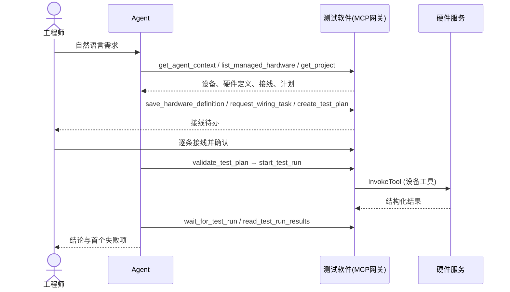

# 智能化通用测试软件 设计文档

| 项 | 内容 |
|---|---|
| 项目代号 | HardwareHarness |
| 文档版本 | v1.2 (2026-09-24) |
| 依据 | 《智能化通用测试》汇报材料 (doc/ppt) 及当前代码实现 |
| 适用范围 | 通用测试软件桌面端、Python 后端、硬件 MCP 服务、AI Agent 集成 |

本文按汇报材料的主线组织: 先说明问题和目标, 再给出通用化和智能化两步的设计。每个设计点标注实现状态:

- ✅ 已实现: 代码中已有, 并在示例工程中使用过
- 🟡 部分实现: 机制存在, 但范围或强度低于设计目标
- ⏳ 规划: 尚无代码

---

## 1. 背景与目标

### 1.1 现状问题

每个被测对象配一套定制测试软件和设备。被测产品的接口、协议、供电、时序不同; 台架侧的采集卡、电源、串口、继电器 SDK 不同; 初始化、激励、测量、判定、清理代码也不同。对四套归档定制软件的梳理 (见 `doc/research/`) 归纳出五个代价:

| 代价 | 表现 |
|---|---|
| 迭代周期长 | 换一个产品, 重写代码、重新联调 |
| 复用成本高 | 电压扫描、串口请求、继电器控制在各项目中重复实现 |
| 变更风险高 | 硬件替换牵动流程、判定和报告代码 |
| 知识不可见 | 量程、安全值、接线关系散落在驱动和脚本中 |
| 验证边界模糊 | 设备访问、协议解析、业务判定相互纠缠 |

### 1.2 核心矛盾

完成一次台架测试所需的能力是层层叠加的, 自下而上为:

```
7 硬件驱动适配        ┐
6 报告和操作界面      │ 通用化消除 (第一步)
5 测试流程 & 判据代码 ┘ → 改为无代码编排
4 协议解析            ┐
3 硬件资源映射        │ 智能化接管 (第二步)
  (判定)              ┘
2 物理接线            ┐ 测试工程师本来擅长
1 现场联调            ┘
─────────── 测试工程师能力线 ───────────
```

测试工程师熟悉被测对象和测试方法, 不熟悉驱动适配和软件工程。能力线以上的层次过去只能外包。解决方案不是培训测试工程师写代码, 而是把能力线以上的层次从人身上挪走。

### 1.3 设计目标

| 编号 | 目标 |
|---|---|
| G1 | 硬件以统一契约接入, 驱动适配层不随项目重写 |
| G2 | 测试流程和判据用结构化、无代码的方式编排, 通用语义覆盖已有项目的全部测试项 |
| G3 | 接线关系建模为数据, 人和 AI 都能读 |
| G4 | 结论与证据由统一模型产生, 可追溯到具体测量步骤和硬件 |
| G5 | 由 AI 接管判定编写、协议解析、资源映射三层, 工程师只需说清楚测什么并完成接线 |
| G6 | 模型、测试数据、被测对象定义和接线关系都不出局域网 |
| G7 | 任何物理动作都有安全底线: 失败或中止后设备回到安全状态; 结果不确定时必须人工确认 |

### 1.4 非目标

- 不替代物理接线和现场联调, 这两层始终由人完成。
- AI 不直接接线, 也不自行确认接线。
- 不提供通用脚本运行时。测试逻辑只能用本文定义的测试语义表达, 扩展走插件契约 (见 6.7)。

---

## 2. 关键设计决策

| 编号 | 决策 | 理由 |
|---|---|---|
| D1 | 先通用化, 再智能化 | 驱动适配和报告层可以写成通用代码, 应当先砍掉; 判定、协议解析、资源映射的差异来自被测对象本身, 写不成通用代码, 但可以由模型按上下文现场推理 |
| D2 | 模型本地部署 | 测试数据、被测对象定义和接线关系都不出局域网。在本行业这是前提, 不是可选项 |
| D3 | 硬件统一通过 MCP 接入 | MCP 是给 AI 用的统一驱动接口。同一份契约既给软件调用, 也给模型阅读 |
| D4 | 一个服务进程只托管一个硬件 | 占用与释放的边界和硬件的物理边界重合。一台设备崩溃不拖垮其他测试, 插拔硬件不需要改动其他服务 |
| D5 | 服务自带使用说明和工具契约 | AI 不读驱动源码, 它读的是"这个工具能做什么、参数是什么、有没有破坏性" |
| D6 | 接线必须建模, 不写在注释里 | 接线每次上台架都会变, 而且必然影响判定。建成模型后, AI 才能把"第 3 通道"翻译成"被测板的某个引脚" |
| D7 | 测试流程是原生结构化数据, 不是文本脚本 | 可以做静态校验, 可以被 AI 增量修改, 也可以被界面编辑 |
| D8 | 硬件差异只收进"调用设备工具"一种步骤 | 66 个归档测试项在台架侧只有七种动作: 配置、激励、等待、采集、判定、记录、恢复。其余步骤与硬件无关, 这是通用化成立的依据 |
| D9 | 保留插件扩展口 | 新增能力按同一契约注册, 不改内核; 不能按契约注册的东西就不该进测试语义 |
| D10 | 模型负责决策, 工具负责执行 | Agent 的能力来自模型本身。我们的工作是准备工具箱和上下文, 而不是给模型画流程图 |
| D11 | 物理结果未知时由人裁决 | 烧录超时、响应无效等情况下, AI 不得自动重发电压、复位、继电器、烧录等操作 |
| D12 | 测试流程绑定台架, 不追求跨台架复用 | 流程由 AI 快速生成, 没有复用需求。`InvokeTool` 直接写 `hardwareId` 和工具名; 不引入"逻辑信号"抽象层 |
| D13 | 手动控制放在测试资源卡片内部, 控件由硬件服务声明 | 画布表达的是物理针脚连接, 不是信号连接, 控件不和针脚做绑定。软件只提供少数通用控件, 硬件能力由服务任意声明, 不在软件里写死硬件接口 |
| D14 | 一个工程 = 一个被测对象 + 一套接线 + 多个功能测试项; 一个功能测试项就是一个测试流程; 测试项可单个或多选批量运行, 列表实时显示各项 Pass / Fail | 测试工程师关心的是"这件产品的哪些功能正常"。测试项与流程一一对应, 流程结论即该项结论, 不必另建功能列表和覆盖关系; 测试项列表本身就是这件产品的功能体检表 (7.5) |
| D15 | 每个操作只定义一次, 界面 RPC 与 AI 工具由同一注册表生成 | 消除一个操作手写六七遍的问题, 也消除两边不一致 |
| D16 | 硬件服务源码只有一份 (SDK + 适配器), 部署时组装成自包含产物 | 保留一键部署到远程电脑的便利, 同时不在 git 中维护多份副本 |

---

## 3. 总体架构

### 3.1 部署视图

```
┌──────────────── 局域网 ────────────────────────────────────────┐
│                                                                │
│  ┌──────────────┐   OpenAI 兼容 HTTP   ┌────────────────────┐  │
│  │ 模型服务器    │◀────────────────────│ 测试终端            │  │
│  │ (本地 LLM)    │                      │ 智能化通用测试软件  │  │
│  └──────────────┘                      └─────────┬──────────┘  │
│                                                  │ MCP (HTTP)  │
│           ┌──────────────────────────────────────┼─────────┐   │
│           ▼                  ▼                   ▼         ▼   │
│   ┌──────────────┐  ┌──────────────┐  ┌──────────────┐ ┌──────┐│
│   │硬件服务 A    │  │硬件服务 B    │  │硬件服务 C    │ │ ...  ││
│   │PCI-1762 继电器│ │CP-118U-I 串口│  │PCI-6208V AO  │ │      ││
│   └──────┬───────┘  └──────┬───────┘  └──────┬───────┘ └──────┘│
│          └──────── 物理接线 ─┴────────────────┴──▶ 被测对象     │
└────────────────────────────────────────────────────────────────┘
```

当前台架:

| 位置 | 服务 | 端口 |
|---|---|---|
| 工控机 192.168.3.63 | PCI-1710L、PCI-1762、PCI-6208V、CP-118U-I 四个硬件服务 | 8011–8014 |
| 测试终端本机 | FireDAP 调试器服务 | 127.0.0.1 |

### 3.2 进程视图 (测试终端)

```
Renderer (React + assistant-ui)
   │ Electron IPC (preload)
Electron 主进程 ──子进程, stdio JSON-RPC 2.0──▶ Python 后端 (hardwareharness_backend.host)
   │                                              ├─ MCP 网关: 127.0.0.1/mcp, Bearer 令牌, 仅接受回环连接
   │ 启动 opencode serve (127.0.0.1)              ├─ MCP 客户端 ──Streamable HTTP──▶ 各硬件服务
   ▼                                              └─ SSH / 本地 shell ──▶ 硬件服务的启停、状态、日志
OpenCode Agent ──MCP──▶ 网关
   │ OpenAI 兼容接口
模型服务 (baseUrl 可配置)
```

- **桌面端**: Electron + React。负责界面, 本身不含业务逻辑。
- **Python 后端**: 业务核心, 负责设备、工程、硬件定义、接线、资料、测试编排与执行, 以及对 AI 的 MCP 网关。
- **Agent 运行时**: 内置 OpenCode 作为 sidecar 进程, 通过 MCP 使用网关工具, 通过 OpenAI 兼容接口访问模型。
- **契约**: 后端操作注册表是唯一来源 (见 3.4)。

### 3.4 操作注册表 (D15) ✅

后端每个对外操作只在应用服务上声明一次:

```python
class TestingApplication:
    @operation("testing.execute")          # 所需能力; 装饰器在调用前统一鉴权
    async def start_run(self, context, input): ...
```

`application.NAMESPACES` 列出各命名空间的服务类 (`system` `devices` `projects` `wiring` `manual` `testing`), 注册表 `DESKTOP_METHODS` 由其中带 `@operation` 的方法自动得到, 线上名称为 `命名空间.驼峰方法名` (如 `testing.startRun`)。

| 产物 | 说明 |
|---|---|
| JSON-RPC 方法 | 主进程只有一个通用过程 `invoke({ operation, args })`: 检查 `operation` 属于注册表, 以桌面端人员身份转发 `application.<operation>`; 后端按注册表分发并鉴权 |
| TS 方法表 | `python/scripts/generate_operations.py` 生成 `packages/contracts/src/operations.generated.ts` (`DESKTOP_OPERATIONS`); Python 测试检查生成文件未过期, TS 编译期断言 `BackendApplication` 的方法集合 = 生成的方法表 (生命周期方法除外) |
| MCP 平台工具 | 每个工具是一条 `Tool` 声明 (名称、描述、输入 schema、输出 schema、注解), `operation` 字段指向注册表中的操作, 能力继承自该操作; 少数组合工具提供自己的 `call` 与 `capability` |
| 权限检查 | 界面和 AI 走同一个 `@operation` 鉴权; 调用方 (human / agent / system) 由 `context` 区分 |

- 工具声明按领域就近存放: `application/tools.py` (设备、硬件、工程、接线)、`testing/tools.py` (计划与运行)、`mcp_gateway/{agent_services,contract_tools}.py`; `mcp_gateway/tool_registry.py` 只负责汇总、按能力过滤、解析参数和包装结果。手写的工具 JSON 已删除。
- 输入校验在后端: 结构化参数由对应的 `parse_*` 统一校验 (如 `parse_hardware`、`parse_manual_tool_invocation_input`), 主进程不再对应用操作做 zod 校验; 仅设置、Agent、对话框、资源包、事件等主进程自有的过程保留 zod。
- 参数语义与 MCP 一致按 JSON 处理: 主进程转发前去掉对象中值为 `undefined` 的成员; 末尾缺省参数取后端默认值。
- 前端: preload 为每个生成的操作构造具体函数 (contextBridge 不能暴露 Proxy), 再用一张别名表补上界面沿用的名称 (如 `projects.current` → `document`, `wiring.update` → `updateDocument`) 和需要主进程对话框的过程 (导入导出资源包、选择文件夹/图片、导出文本)。`HardwareHarnessApi` 仍是界面的类型契约; 测试检查 preload 实际调用的 tRPC 过程 = 路由器的过程集合、经 `invoke` 到达的操作 = 生成的方法表 (由主进程代调的 `devices.exportBundle`/`importBundle` 除外)。
- 结果: 界面可以调用全部注册操作 (如 `devices.callTool`), 由后端鉴权决定是否允许; 原来返回 `void` 的删除类操作在类型上改为返回被删对象的 id。

### 3.3 模块划分 (Python 后端)

| 模块 | 职责 |
|---|---|
| `host` | 进程入口、stdio JSON-RPC、编解码、按注册表分发 |
| `application` | 应用服务门面与操作注册表、权限 (`authorization`)、执行协调 (`execution`)、平台工具声明 (`tools`) |
| `devices` | 远程计算机、硬件服务注册、MCP 客户端、在线检测、生命周期、硬件目录 |
| `projects` | 工程的创建、打开、保存 |
| `wiring` | 工位接线、接线待办 |
| `testing` | 测试计划模型、步骤目录、表达式、校验与编译、执行引擎、运行状态、插件、计划与运行工具声明 (`tools`) |
| `workspace` | 工程文件与参考资料 (references) |
| `mcp_gateway` | 面向 AI 的工具汇总与调用 (`tool_registry`)、Agent 指令、结果脱敏 |
| `contracts` | 领域类型与校验、操作注册 (`operations`: `@operation`、`Tool`)、MCP 公共契约 (`mcp`) |
| `storage` | 设置、密钥 (Electron safeStorage 加密)、文件存储 |

---

## 4. 设备管理 (第一步 · 通用化)

### 4.1 硬件服务契约 ✅

每个硬件资源是一个独立的 MCP 服务进程, 内部分三层:

```
统一接口层   参数校验 · 结果格式 · 错误分类 · 工具契约
驱动适配层   通道 · 量程 · 安全状态
厂商 SDK     DLL (ctypes) / 原生 CLI / pyOCD
```

软件和 AI 只看统一接口层。更换板卡时, 上层不用动。

服务契约要求:

| 项 | 要求 |
|---|---|
| 传输 | Streamable HTTP, 路径 `/mcp`, Bearer 令牌鉴权 |
| 一服务一硬件 | `list_hardware` 必须恰好返回一个硬件, 且 `hardwareId` 与注册值一致, 否则后端判定服务违规 |
| 公共只读工具 | `get_server_info`、`list_hardware`、`get_hardware_info` (含能力详情, 如电压范围)、`get_pinout` |
| 安全停机工具 | `hardwareharness_prepare_shutdown`: 停服务前进入安全状态 |
| 设备工具 | 以设备前缀命名, 如 `pci6208v_set_voltage` |
| 输入契约 | 每个参数有类型、范围和描述 |
| 输出契约 | 统一信封 `{ok, message, data, error, meta}`, `data` 按工具定型 |
| 注解 | `readOnlyHint` / `destructiveHint` / `idempotentHint` |
| 操作语义 | 放在 `_meta.hardwareharness.operationSemantics` 中 (见 4.3) |
| 执行模式 | 设置 `HARDWARE_DRY_RUN=1` 切换为内存模拟, 通过 `executionMode` 对外报告 |

安全状态:

- 设备打开后、停止前、收到停机请求时都执行 `safe_state`。
- 安全值可配置, 如 PCI-6208V 默认 0 V。

### 4.2 已接入硬件 ✅

| 硬件 | 类别 | 设备工具 |
|---|---|---|
| PCI-1762 | 继电器卡 | `set_relay` `set_bank` `read_bit` `safe_state` |
| CP-118U-I | 多串口卡 | `configure_port` `write_text` `write_hex` `read_rx` `clear_rx` `flush` `get_line_status` |
| PCI-1710L | 多功能采集卡 | `configure_ai` `read_voltage` `read_bit` `set_level` `safe_state` |
| PCI-6208V | 模拟输出卡 | `set_voltage` `read_last` `safe_state` |
| FireDAP | 调试器 | `list_probes` `get_board_reference` `import_firmware` `inspect_firmware` `flash` `verify` `target_info` `reset` `read_sram` `wait_job` `get_job` |

FireDAP 的烧录和校验是长任务, 以 job 形式提交, 通过 `wait_job` / `get_job` 查询结果。

### 4.3 操作语义 ✅

后端为每个设备工具解析出一份操作语义, 编排校验和执行引擎都依赖它:

| 字段 | 含义 |
|---|---|
| `kind` | `read` / `configure` / `actuate` / `safe` |
| `retry` | `safe`: 可重试; `never_after_dispatch`: 已下发后不得自动重发 |
| `stateRequirements` / `stateEffects` | 状态前置与效果。例如 `read_voltage` 要求先 `configure_ai` |
| `evidenceType` | 返回值记录成哪类证据 (measurement / observation / ...) |
| `safetyAction` | 调用后需要登记的安全恢复动作。例如 `set_voltage` 对应 `safe_state` |
| `outcomeOnInvalidResponse` | 响应无效时视为 `unknown` |

服务可以在 `_meta` 中显式声明操作语义。未声明时, 后端按工具注解和命名规则推断。

🟡 当前五个已知硬件的状态前置和安全动作写死在 `testing/resolver.py` 中。新接入的硬件应在服务端显式声明, 见第 11 节。

### 4.4 服务生命周期与在线检测 ✅

- **注册**: 远程计算机 (`execution: ssh | local`) 和其上的硬件服务 (`transport: mcp-http`, URL, 令牌, 生命周期命令)。
- **在线检测**: 先尝试 MCP 连接; 失败时通过 SSH 执行 `statusCommand` 判定服务状态。硬件状态取值为 `initializing / open / unreachable / faulted / closing / closed`。
- **启停与重启**:
  1. 先调用 `hardwareharness_prepare_shutdown` 安全停机。
  2. 执行启停命令。
  3. 重连 (最多 20 次)。
  - 安全停机失败时拒绝停止, 除非持有 `devices.forceStopServers` 权限强制停止。AI 没有这个权限。
- **日志**: 通过远程 shell 读取服务日志尾部, 每次 1–2000 行。

### 4.5 硬件占用 🟡

设计目标: 硬件可被任意测试终端占用, 用完释放。

现状: 只在单个桌面实例内防止并发执行 (`ExecutionCoordinator`)。多个终端之间没有租约或锁协议。

设计 ⏳: 租约由硬件服务 SDK 实现, 不在测试终端加锁。

| 操作 | 说明 |
|---|---|
| `lease_acquire(holder, ttlMs)` | 返回 `leaseId`; 已被他人持有时返回持有者和到期时间 |
| `lease_renew(leaseId)` | 持有期间周期续约 |
| `lease_release(leaseId)` | 释放 |

- 持有租约期间, 非只读工具必须带 `leaseId`, 否则拒绝。
- 测试运行、批量运行、手动控制会话 (4.6) 都先取得租约。
- 租约过期时服务执行 `safe_state`。

### 4.6 资源控制面板 (D13) ⏳

画布上的每张测试资源卡片内部有一个控制面板, 用来实时查看和手动操作这张资源自己的通道 (继电器 K3、AO2、串口 P1 ...)。面板**不和被测对象的针脚或信号做绑定**。

**控件由服务声明**, 软件只提供少数通用控件:

| 控件 | 用途 |
|---|---|
| `toggle` | 开关: 继电器、数字输出 |
| `number` | 数值输入或滑条: 电压、电流设定 |
| `select` | 枚举选择: 量程、波特率 |
| `button` | 一次性动作: 复位、`safe_state` |
| `readout` | 只读数值: 电压读数、状态位 |
| `stream` | 数据流: 串口接收、CAN 报文 |
| `form` | 任意工具参数, 按工具的输入 schema 渲染 |

`form` 能调用任意工具, 所以任何硬件能力都能上面板, 不受控件种类限制。

服务通过 `get_panel` 返回面板声明:

```yaml
panel:
  - group: 继电器
    controls:
      - id: K3
        widget: toggle
        pins: [CN1.5, CN1.6, CN1.7]          # 仅用于高亮
        write: { tool: pci1762_set_relay, args: { channel: 3, closed: $value } }
  - group: CAN0
    controls:
      - { id: can0_cfg, widget: form, tool: can_configure }
      - id: can0_rx
        widget: stream
        pins: [J1.2, J1.7, J1.3]             # CANH / CANL / GND
        read: { tool: can_read_frames }
      - { id: can0_tx, widget: form, tool: can_send_frame }
```

**多针脚**: `pins` 只是一个列表, 只用于标注。鼠标悬停在控件上时, 高亮卡片上的这些针脚, 并顺着画布上的物理连线高亮对端针脚 (如 "K3 → 霸天虎 PA0")。

**扩展级别**:

| 级别 | 做法 | 适用 |
|---|---|---|
| L0 | 服务未声明面板时, 按工具列表自动生成 `form` (即现有手动调用功能) | 新接入硬件, 零成本 |
| L1 | 服务声明面板 | 大部分板卡 |
| L2 | 服务提供自定义 HTML 界面, 在沙箱 iframe 中渲染, 工具调用经软件转发 (MCP Apps 模式) | 示波器、总线分析等复杂仪器, 预留 |

**规则**:

- 手动操作与测试步骤走同一条执行路径: 取得租约、记录物理操作、登记安全动作。
- 手动控制以会话为单位: 开始时取得租约; 结束或关闭工程时提示执行已登记的安全动作; 会话存在时不能启动占用同一硬件的运行。
- 运行中面板只读, 显示值来自运行事件, 停止轮询。
- 破坏性操作二次确认; 结果未知时进入人工核销 (7.3)。
- 轮询: 只轮询只读且可重试的工具; 输出类控件显示最后写入值, 不访问硬件。
- `stream`: 串口、CAN 等由 SDK 提供带序号的环形缓冲区, 读取时传入游标, 多个读者互不影响, 面板和测试流程可以同时读。

### 4.7 服务 SDK 与部署 (D16) ⏳

```
git 中                              部署时组装 → 远程目录
devices/sdk/                        SDK + 一个适配器 + 依赖包 + 生成的启停脚本
devices/adapters/<型号>/            (自包含, 远程无需联网和 git)
devices/templates/*.ps1
```

- **SDK 负责**: 公共工具、结果信封、生命周期、`safe_state`、租约、环形缓冲区、面板和操作语义声明、dry-run。
- **适配器只写**: 驱动映射 (工具 → 厂商 SDK 调用)、面板、操作语义。
- **远程目录**只是部署产物, 不再当源码; `pull` 仅用于应急。
- **现状**: `mcp_servers/servers/` 下四个目录各含全部四张卡的代码 (每份约 3.6k 行), 启停脚本也各有一份。部署由 `deploy.ps1` + `tools/remote-source.cjs` 完成 (暂存、哈希校验、备份、远程测试、健康检查、失败回滚), 服务清单写死在脚本参数中。

---

## 5. 硬件定义与工位接线 (第一步 · 通用化)

### 5.1 硬件定义 ✅

- **分类**: 硬件分两类 (`kind`):
  - `managed`: 受管硬件, 由 MCP 服务托管, 可调用工具。
  - `passive`: 被动设备, 如被测对象。只有定义, 没有服务。
  - ⏳ 目标 (D14): 改为 `resource` (测试资源) 和 `dut` (被测对象)。测试资源的服务是可选的, 没有服务的转接板、线缆、手动电源按"无服务的测试资源"处理, 能上画布、能接线, 但没有控制面板。
- **结构**: 硬件 → 端口 → 针脚。端口和硬件可以配图片, 端口在画布上的位置用 `side` + `offset` 描述。
- **标识**: 采用层级命名。
  - 硬件: `<计算机>.<设备>`, 如 `PC1_MCP.PCI6208V_CARD_0`
  - 端口: `<硬件>.<端口>`, 如 `PC1_MCP.CP118U_I_CARD_0.P1`
- **来源**: 可以人工编辑, 也可以由 AI 根据手册或截图生成 (见 8.2), 生成后进入硬件目录并加入画布。

### 5.2 工位接线模型 ✅

```
ProjectWiring
├─ nodes[]        画布节点: hardwareId, 位置, 尺寸, 端口位置
└─ connections[]  已确认连接: connectionId, portA, portB,
                  pins[{a, b}], confirmedAt, confirmedBy
```

- **两种视图**: 画布看端口之间的连接, 列表看每一对针脚。
- **归属**: 一个工程只有一套接线 (D14), 包含多个测试资源和一个被测对象; 工程内的所有功能测试项共用这套接线。测试流程不单独声明接线依赖: 流程用到哪些硬件, 由其中的 `InvokeTool` 步骤推出。
- **追溯**: 每次运行把当时的接线快照写入运行目录 (`wiring.json`), 用于回答"这次是按什么接线测的"。
- **作用**: 接线是 AI 做资源映射的上下文。它把"采集通道"翻译成"PCI-6208V 的某一路 → 被测板的某个引脚"。

### 5.3 接线待办 (人在回路) ✅

1. AI 或人发起接线任务 `request_wiring_task`。每个任务是一对端口和若干针脚, 动作为 `connect` 或 `disconnect`。
2. 任务状态: `pending → in_progress → confirmed | rejected | cancelled | timed_out | failed`。
3. 现场人员照着待办接线, 在软件里逐条点"已完成"或"无法完成"。确认后的连接写入工程接线。
4. **确认只能由人完成**: AI 没有 `wiring.confirm` 权限。
5. **开测门禁**: 流程涉及的硬件上还有 `pending` / `in_progress` 的接线任务时, 拒绝启动测试。与其他硬件相关的接线待办不影响本流程。

---

## 6. 测试编排语义 (第一步 · 通用化)

### 6.1 总览

通用测试语义 = 三个区域 + 四类步骤 + 一套表达式 + 一种结论。

### 6.2 计划结构 ✅

```yaml
schemaVersion: 2
revision: <int>            # 乐观锁, 每次保存 +1
name: 模拟采集精度         # 功能测试项名称
description: ...
parameters: {...}
variables: {...}
regions:
  prepare: [ ...steps ]    # 准备
  test:    [ ...steps ]    # 测试
  cleanup: [ ...steps ]    # 清理
```

- **功能测试项** (D14): 一个计划就是一个功能测试项, 一一对应。计划的 `name` / `description` 就是被测功能的名称和说明, 计划的结论就是该项的结论。一个工程 (一个被测对象) 有多个测试项, 共用同一套接线; 不单独维护功能列表, 也不需要流程到功能的覆盖关系。
- **存储**: 存为 `.hardwareharness/plans/<id>.hhplan.yaml`, 使用 round-trip YAML, 拒绝自定义标签。
- **旧版本**: 只接受 schemaVersion 2, 不在应用内做格式迁移。
- **清理区**: 无论 Pass、Fail、Aborted 还是 Error 都执行, 保证设备最终回到安全状态。这条来自归档项目的教训: 有的项目"停止测试"按钮并不关电源。

### 6.3 步骤类型 ✅

共 17 种内置步骤, 另有插件类。

| 类别 | 步骤 | 作用 |
|---|---|---|
| 流程 (容器) | Sequence, Group, If, Repeat, ForEach, Parallel, Retry | 组织子步骤, 决定执行顺序 |
| 数据 | SetVariable, Evaluate, Delay, WaitUntil | 在步骤间传递和加工数据, 控制节奏 |
| 硬件 | InvokeTool | 接触硬件的步骤, 见下表 |
| 判定 | Equal, Range, Tolerance, Bitmask, PublishResult | 把测量值变成结论 |
| 插件 | 由插件注册 | 见 6.7 |

InvokeTool 的设置:

| 设置 | 说明 |
|---|---|
| `hardwareId` | 目标硬件 |
| `toolName` | 调用的工具 |
| `bindingRevision` | 工具契约版本 |
| `arguments` | 工具参数 |
| `timeoutMs` | 超时, 默认 30 s |
| `errorPolicy` | `error` 或 `fail` |

判定步骤:

- Equal / Range / Tolerance / Bitmask 可以挂 `requirementIds`, 用于统计需求覆盖。功能测试项的结论取自整个流程, 判定步骤不需要再挂功能。
- 需求覆盖状态为 `Passed / Failed / NotRun / InsufficientEvidence`。

### 6.4 表达式 ✅

- **命名空间**:
  - `steps.<步骤>.<字段>`
  - `parameters.<参数>`
  - `variables.<变量>`
  - ForEach 内还可用 `item` 和 `index`
- **语法**: 类 CEL 的受限子集。

### 6.5 静态校验 ✅

编译器检查以下几类问题:

| 检查 | 错误码 / 规则 |
|---|---|
| 结构、ID、硬件与工具绑定、参数模式 | — |
| 引用顺序: 被引用的步骤一定先执行 | `expression.control_flow` |
| 字段存在 | `expression.field_missing`; 无法证明时给警告 `field_unproven` |
| 类型匹配 | `expression.type_mismatch` |
| 状态前置: 工具的 `stateRequirements` 在执行路径上已满足 | — |
| 重试块只能包含幂等操作, 烧录等操作不能放进 Retry | — |

触发时机:

- 保存时做结构校验, 返回问题但不拦截保存。
- 显式校验和启动运行时做完整编译, 编译不通过不能运行。
- 编辑器实时分析草稿。

### 6.6 结论与证据 ✅

- **结论**: 按严重度递增为 `NotSet < Pass < Inconclusive < Fail < Aborted < Error`, 汇总时取最严重者。
- **证据类型**:
  - `measurement`: 测量值
  - `observation`: 观测, 如固件信息
  - `assertion`: 断言, 由判定步骤产生
  - `note`: 由 PublishResult 发布
- **追溯**: 每条断言可追溯到来源测量步骤和硬件。

### 6.7 插件扩展 ✅

插件实现 `TestStepPlugin` 协议: `type_name`、`settings_schema`、`output_schema`、`validate`、`prepare`、`run`、`cleanup`。

- **注册**: 通过 Python entry point 注册, 分组为 `hardwareharness.test_steps` 和 `hardwareharness.result_listeners`。
- **生效**: 注册后自动进入步骤目录、校验和执行, 不需要修改内核。
- **硬件访问**: 插件经上下文提供的 `invoke_device` 访问硬件, 同样受操作语义约束。

---

## 7. 测试执行 ✅

### 7.1 执行流程

```
start_run
  ├─ 门禁: 流程涉及的硬件上无未完成接线任务
  ├─ 门禁: 目标硬件无未决物理操作
  ├─ 门禁: 本机无其他执行占用该硬件
  ├─ 编译计划 (6.5)
  ├─ 保存计划快照和接线快照
  ├─ prepare → test
  ├─ finally: cleanup (有超时, 默认 60 s)
  └─ 回放安全动作 safetyAction → safetyStatus
```

- **控制**: 运行可以暂停、继续、中止。
- **幂等**: 启动请求带 `requestId`, 重复提交不会重复执行物理运行。

### 7.2 运行产物

| 产物 | 位置 | 内容 |
|---|---|---|
| `plan.hhplan.yaml` | `runs/<runId>/` | 本次运行使用的计划快照 |
| `wiring.json` | 同上 | 本次运行时的工程接线快照 |
| `events.jsonl` | 同上 | 步骤事件流 |
| `results.jsonl` | 同上 | 证据与判定结果 |
| `summary.json` | 同上 | 运行快照: 结论、清理状态、安全状态、需求覆盖、物理操作 |
| `run.log` | 同上 | 可读日志 |
| `runtime.sqlite3` | `.hardwareharness/` | 运行与物理操作状态 |

### 7.3 物理操作状态与人工核销

- **状态流转**: `accepted → dispatched → succeeded | failed | outcome_unknown | recovery_required`
- **进入 `outcome_unknown` 的情况**: 超时、取消、响应无效, 或进程崩溃时仍处于 `dispatched` 的操作。这些操作标记 `recoveryRequired`。
- **后果**: 在人工核销之前, 相关硬件不能启动新运行。
- **核销方式**: 人查看实际状态后调用 `reconcile_operation`, 结论为 `confirmed_succeeded` / `confirmed_failed` / `safe_state_restored`, 并附说明。
- **安全状态**: 取值为 `NotRequired / Pending / Verified / Failed / Unknown`。

🟡 桌面端目前只高亮显示未决操作, 还没有核销入口。

### 7.4 批量运行 (D14) 🟡

用户在测试项列表 (7.5) 中多选若干功能测试项, 按列表顺序批量运行; 每项运行它自己的流程。只选一项时就是单次运行。

1. **开跑前一次性检查**全部选中的测试项: 编译、接线待办、未核销的物理操作; 并一次性取得全部涉及硬件的租约。避免跑到一半才发现某个流程编译不过, 或硬件被其他终端占走。
2. **按顺序执行**。每个测试项是一次独立运行, 各自执行准备/测试/清理, 清理一定执行。
3. **停止策略**:
   - 遇到 Fail: 默认继续, 可配置为停止。
   - 遇到 Error、Aborted, 或出现结果未知的物理操作: 必须停止, 后续测试项可能在不安全状态上执行。
4. **中止**: 当前测试项执行清理后结束, 其余测试项标记为未执行。
5. **记录**: `batches/<batchId>/batch.json` 引用各次运行的 `runId`, 记录当前被测件的序列号 (7.5)。批次结论取最严重者。
6. **结果表**: 测试项 × 结论 × 首个失败项 × 证据链接 (运行目录), 报告层直接使用。
7. **AI 工具**: `start_batch`、`wait_for_batch`; 单个测试项的运行接口不变。
8. **预设**: 工程可保存常用的批次组合 `sequences[] = {name, planIds[], stopOnFail}`。

现状: 1–4、7 已实现 (`testing/batch.py`, AI 工具 `start_test_batch` / `wait_for_test_batch` / `abort_test_batch`)。批次记录存于 `runtime.sqlite3` 的 `batches` 表, 未单独写 `batch.json`; 硬件租约待 T2; 结果表导出与预设未做。

### 7.5 功能测试页面: 测试项列表 (D14) ✅

原状: 编排测试页面左侧的"文件"页签是测试计划文件列表, 只用于打开和编辑。目标: 改为这件产品的**功能测试项列表**, 同时承担选择、运行和结果展示。

```
┌ 测试项 ─────────────── 霸天虎 V2 · SN 0012 ┐
│ 12 项  ● 9 通过  ● 1 失败  ○ 2 未测          │
│ [运行所选] [全部运行] [重测失败项] [新一件]  │
├──────────────────────────────────────────────┤
│ ☑ ● 程序烧录与校验          通过   09:12     │
│ ☑ ● 模拟采集精度            失败   09:14     │
│ ☐ ◐ 串口通信                运行中 3/5 步    │
│ ☐ ○ CAN 收发                排队             │
│ ☐ ○ 低功耗唤醒              未测             │
└──────────────────────────────────────────────┘
```

- **列表项**: 每行一个功能测试项, 显示复选框、状态灯、名称、结论、最近运行时间。点击名称在中间编辑区打开该项的流程; 行上可新建、重命名、删除、拖动排序 (排序即批量运行顺序)。
- **运行**: 勾选后点"运行所选", 一项为单次运行, 多项为批量运行 (7.4)。另有"全部运行"和"重测失败项"。
- **状态灯**: 显示这件产品上每项功能在最近一次测试后的结论, 运行过程中实时更新 (订阅运行事件)。

| 状态 | 颜色 | 含义 |
|---|---|---|
| 通过 | 绿 | 最近一次运行结论为 Pass, 该功能正常 |
| 失败 | 红 | 最近一次运行结论为 Fail, 该功能不正常; 悬停显示首个失败项 |
| 未测 | 灰 (空心) | 当前被测件上还没有运行过 |
| 排队 / 运行中 | 蓝 (运行中带进度) | 在本次批量中等待或正在执行 |
| 无效 | 橙 | 结论为 Error / Aborted, 或有未核销的物理操作: 测试本身没完成, 不代表功能好坏, 需要重测 |
| 需重测 | 原颜色 + 角标 | 该项流程在上次运行后被修改 (revision 变化), 或工程接线与运行时的接线快照不同; 结论仅供参考 |

- **汇总**: 列表顶部显示被测对象名称、当前序列号和各状态数量; 全部通过时整件产品判为合格。
- **被测件与轮次**: 一个工程对应一种被测对象, 但会依次测多件实物。点"新一件"输入序列号, 开始新一轮, 所有状态回到未测; 以往各轮的运行和批次记录保留, 可在"运行记录"页签按序列号查看。
- **数据来源**: 状态由每个测试项在当前轮次内最近一次运行推出, 不另存结论。后端提供 `testing.listItemStatus` (每项: `planId`、结论、`runId`、完成时间、首个失败项、是否需重测), 以及轮次操作 `testing.startUnit(serialNumber)`; 当前轮次保存在 `runtime.sqlite3`。
- **其他页签**: "组件"页签不变; "运行记录"页签保留, 用于查看历史运行日志。

现状 (前端重写后): 页面为三栏 — 左侧测试项列表 (被测件、搜索、全选与汇总、行内状态灯/结论/耗时、拖动排序, 底部"运行所选 / 全部运行 / 失败即停"与批次进度), 中间流程编辑或运行视图, 右侧"属性 / 组件库 / 运行日志"。与上文的差异:
- 排序保存在 `runtime.sqlite3` 元数据 `testItemOrder`, 不写入工程文件; 未出现在排序中的新测试项按名称排在末尾。
- "需重测"只按流程 revision 判断, 显示为"已过期"; 接线快照比对与"重测失败项"按钮、首个失败项悬停尚未实现。
- 后端接口: `testing.listItemStatus`、`testing.reorderItems`、`testing.startUnit` / `currentUnit`、`testing.startBatch` / `abortBatch` / `waitForBatch` / `currentBatch`; 状态变化通过事件推送, 列表实时刷新。

---

## 8. AI Agent (第二步 · 智能化)

### 8.1 原理

| 组成 | 说明 |
|---|---|
| 大脑 | 本地大语言模型。理解自然语言描述的测试需求, 推理下一步做什么 |
| 工具箱 | 设备驱动和平台能力封装成的工具。负责真正执行动作 |
| 循环 | 思考 → 行动 → 观察 → 再思考。每一步都基于真实返回结果决定下一步, 不是写死的脚本 |

输入是人的需求加上工程上下文 (设备、硬件定义、接线、计划), 输出是硬件定义、接线待办、测试计划、运行结论。

### 8.2 运行时 ✅

- **启动**: 桌面端内置 OpenCode, 以 `opencode serve --hostname 127.0.0.1` 启动。
- **模型接入**:
  - 配置为 OpenAI 兼容 provider, `baseURL` 指向模型服务。
  - 部署要求: `baseURL` 必须指向局域网内的模型服务器 (D2)。
  - 🟡 软件目前不校验该地址, 默认值是公网地址, 见第 11 节。
- **工具接入**: OpenCode 通过 MCP 访问后端网关。网关只监听回环地址, 需要令牌。
- **配置隔离**: OpenCode 的配置目录隔离在应用数据目录下。
- **界面**: 对话界面基于 assistant-ui。

### 8.3 工具箱三层

全部通过 MCP 暴露给 AI。每个工具自带输入/输出契约, 并标注只读或有破坏性。

**第一层 · 硬件工具 ✅**: 随硬件服务插拔。网关以 `<serverId>__<tool>` 的名称转发给 AI, 清单见 4.2。

**第二层 · 平台工具 ✅**: 由通用测试软件内置, 共 49 个。

| 分组 | 工具 |
|---|---|
| 工程 (4) | `get_project` `initialize_project` `open_project` `save_project` |
| 设备管理 (9) | `list_remote_computers` `get_remote_computer_status` `list_mcp_servers` `get_remote_mcp_service` `start/stop/restart_remote_mcp_service` `read_remote_mcp_logs` `list_managed_hardware` |
| 硬件定义 (7) | `list_hardware_catalog` `get/save/remove_hardware_definition` `set/remove_hardware_image` `add_managed_hardware_to_canvas` |
| 接线 (4) | `request_wiring_task` `cancel_wiring_task` `get_wiring_task` `list_wiring_tasks` |
| 测试编排 (7) | `list_test_plans` `get_test_plan` `get_test_step_catalog` `list_test_device_tools` `create_test_plan` `apply_test_plan_operations` `validate_test_plan` |
| 测试执行 (11) | `start/pause/resume/abort_test_run` `get_test_run` `list_test_runs` `read_test_run_events` `read_test_run_results` `wait_for_test_run` `list_test_recovery_items` `reconcile_test_operation` |
| 上下文与资料 (7) | `get_agent_context` `get_tool_contract` `read_reference` `register_reference` `get_execution_availability` `wait_for_status` `import_firmware_artifact` |

补充说明:

- 编排和执行类写操作带 `requestId`, 重试时幂等。
- 计划采用增量修改 (`apply_test_plan_operations`), 基于 `revision` 乐观锁。

**第三层 · 技能 (Skill)**: 按需加载的领域知识包, 用时展开, 用完释放。

| 技能 | 内容 | 状态 |
|---|---|---|
| `stm32f407-batianhu-v2` | 被测板的引脚、时钟、外设、跳帽约束、硬件预检清单, 以及 Keil 工程的新建、环境检查、构建脚本 | ✅ 内容已有 |
| `mcp_server` | 输入一份硬件手册或 SDK 头文件, 生成新硬件服务: 工具契约、参数校验、安全状态、契约测试、部署脚本 | ⏳ 规划 |
| 测试报告写作规范 | 测试报告与文档的写作规范 | ⏳ 规划 (现有 `doc_writer` 是通用的去 AI 腔改写规范) |

🟡 技能目前还没有接入 Agent 运行时; 可按需读取的上下文靠网关的参考资料机制 (`read_reference` / `register_reference`) 提供。技能加载方案见第 11 节。

### 8.4 权限与边界 ✅

- **权限模型**: 按能力授权。操作者分三类:
  - `human` 与 `system`: 拥有全部能力。
  - `agent`: 只拥有白名单内的能力:
    - 读取: `*.read`
    - 管理: `hardware.manage` / `projects.manage` / `references.manage` / `testing.manage`
    - 执行: `hardware.executeTools` / `testing.execute`
    - 控制服务: `devices.controlServers`
    - 发起接线: `wiring.request`
- **AI 不能做的事**:
  - 确认接线
  - 强制停止服务
  - 在物理结果未知时自动重发非幂等操作 (由 `retry: never_after_dispatch` 和未决操作门禁共同保证)
- **结果脱敏**: 网关返回给 AI 的结果中, 敏感字段被替换为 `[REDACTED]` (`mcp_gateway/redaction.py`)。

### 8.5 AI 编写硬件服务的链路 ⏳

目标: 内嵌 Agent 加载 `mcp_server` 技能后, 能从手册完成一个新硬件服务的编写、验证、部署和上线。

| 环节 | 现状 | 需要的基础设施 |
|---|---|---|
| ① 读资料 | `hardware-manuals/`、`read_reference` | PDF 和厂商头文件的文本抽取与检索; 厂商 SDK 头文件和示例按型号入资料库 |
| ② 探查远程环境 | 无 | `probe_remote_computer`: 操作系统、Python 版本、已装驱动和 DLL 路径、板卡枚举、已占用端口 |
| ③ 写代码 | 只能参考已有服务 | 服务 SDK + 脚手架 (`new-device <型号>`) + 参考适配器 + 技能文档 (4.7) |
| ④ 本地验证 | `test.ps1`, 依赖仓库外的虚拟环境 | **合规测试套件**: 只返回一个硬件、信封格式、每个工具都声明语义和注解、参数带范围和单位、`safe_state` 幂等、面板引用的工具存在; dry-run 模拟层; uv 锁定环境 |
| ⑤ 远程试探 | 无 | 远程试跑: 上传脚本到临时目录, 带超时运行并返回输出, 不影响在运行的服务; 每次人工批准 |
| ⑥ 部署 | `deploy.ps1` + `remote-source.cjs` | 迁入后端成为平台操作; 服务清单数据驱动; 离线依赖包; 自动分配端口; 自动生成令牌并存入密钥库; 开机自启 |
| ⑦ 注册上线 | `servers.json` 与软件设备注册表是两份数据 | 合为一份; 部署后自动注册; 由 `get_pinout` 生成硬件定义并上画布; 面板自动出现 |
| ⑧ 上电联调 | 无 | 服务分"草稿"和"已验收"; 安全值和操作语义由人审核; 首次真实动作在空载下由人对照面板执行; 草稿服务只能手动使用, 不能进批量运行 |
| ⑨ 版本追溯 | `verify.ps1` 比对哈希 | 部署写入 git commit 和是否有未提交修改; `get_server_info` 返回源码与 SDK 版本; 运行记录保存服务版本 |
| ⑩ 权限 | 无 | `devices.deploy` (AI 可发起, 人批准)、`devices.remoteExec` (每次人批准)、`devices.accept` (仅人) |
| ⑪ Agent 工作区 | OpenCode 配置目录隔离在应用数据目录 | 工作目录能访问仓库 `devices/`; bash 权限策略: 允许跑测试, 部署只能经平台工具 |

第一版必须有: ③ ④ ⑥ ⑦ ⑨ ⑩。可后补: ① ⑤ 和 L2 自定义界面。

---

## 9. 端到端流程

以"测试控制板模拟采集精度"为例, 从零到出结论共五段, 前四段由自然语言驱动。



| 段 | 输入 | 输出 | 设计要点 |
|---|---|---|---|
| ① 新增测试资源 | 硬件手册 + 需求 (按通道设电压、读回、查范围、停机复位) | 新 MCP 服务: 代码、契约、安全状态 | 生成的服务须符合 4.1 的契约; 将由 `mcp_server` 技能标准化 |
| ② 新增被测对象 | 手册截图 + 需求 (标出调试下载口、模拟采集口、通信口) | 被动硬件定义 (端口 + 针脚), 进目录、上画布 | 被测对象没有服务, 只有定义 |
| ③ 接线 | 测试目标 + 涉及的资源 | 接线待办 → 人工接线与逐条确认 | AI 不碰线; 未确认完不能开测 |
| ④ 生成方案 | 测试流程描述 (烧录校验、电压点、等待、读数、容差) | 计划: 准备区 (烧录/校验/配置) + 测试区 (遍历电压点: 调工具 → 延时 → 调工具 → 容差判定) + 清理区 (复位输出) | 编译通过才能运行 |
| ⑤ 运行 | — | 运行历史、逐步耗时、返回值、测量值、断言、首个失败项 | 全部结果进日志, 可追溯 |

参考工程: `examples/example1`, 计划为 `customTest-hh-demo` (准备 6 步 / 测试 22 步 / 清理 2 步)。

---

## 10. 数据与存储

```
<工程目录>/
└─ .hardwareharness/
   ├─ project.json            工程 (formatVersion 4): 名称、接线画布与连接
   ├─ plans/*.hhplan.yaml     测试计划
   ├─ runs/<runId>/           运行产物 (7.2)
   ├─ runtime.sqlite3         运行与物理操作状态
   └─ testing-requests.json   幂等请求记录
```

- **应用级数据**: 远程计算机、硬件服务注册、硬件目录、模型配置、密钥。其中密钥由 Electron safeStorage 加密, 密文文件由后端持有。
- **领域 JSON**: 统一使用 camelCase。
- **格式版本**: 应用只读写当前格式, 不内置迁移; 格式变更时用一次性脚本转换已有工程。

⏳ 目标布局 (D14):

```
<工程目录>/.hardwareharness/
├─ project.json            名称、画布节点 (若干 resource + 一个 dut)、物理连线、测试项顺序、批次预设 sequences[]
├─ plans/*.hhplan.yaml     功能测试项, 每项一个流程文件
├─ runs/<runId>/           单次运行产物
├─ batches/<batchId>/      批量运行记录与结果表
└─ runtime.sqlite3         运行状态、被测件轮次 (序列号)
```

---

## 11. 现状差距与待办

| 编号 | 项 | 现状 | 建议 |
|---|---|---|---|
| T1 | 模型本地化 (D2) | 只靠部署约定; 默认 `baseUrl` 为公网地址 | 默认值改为空; 保存时校验 `baseUrl` 为私网或回环地址, 允许管理员显式放开 |
| T2 | 跨终端硬件占用 (4.5) | 仅单实例内加锁 | 在硬件服务侧实现租约 (acquire / renew / release, 带 TTL 和持有者), 执行前获取 |
| T3 | 技能加载 (8.3) | `skill/` 未接入 Agent | 为 OpenCode 配置技能目录, 或由网关将技能暴露为参考资料, 按需加载 |
| T4 | `mcp_server` 技能 | 未实现 | 以 4.1 契约为模板: 手册/头文件 → 服务骨架 + 契约测试 + 部署脚本 |
| T5 | 操作语义声明 | 五个已知硬件的语义在后端按名称推断 | 由各硬件服务在 `_meta` 中显式声明, 后端推断只作兜底 |
| T6 | 设备使用说明 | 服务端 instructions 为通用一句话, 后端不读 | 各服务提供详细 instructions, 网关汇总到 `get_tool_contract` |
| T7 | 接线依赖声明 | 已取消 (D12): 流程涉及的硬件由 `InvokeTool` 推出 | — |
| T8 | 开测门禁范围 | 只拦截流程涉及硬件上的接线待办 | — |
| T9 | 未决操作核销界面 | 仅后端和 MCP 支持 | 在运行日志页增加核销对话框 |
| T10 | 报告层 (G4) | 有结果数据和日志页, 无报告生成 | 基于 `summary` + `results` + 需求覆盖生成报告, 可导出 |
| T11 | 保存时校验 (6.5) | 保存只做结构校验 | 保存时运行完整编译并展示问题 (仍允许保存草稿) |
| T12 | 平台工具注解 | Python 实现的写操作 `destructiveHint` 恒为 false | 按实际副作用标注 |
| T13 | 文档 | `python/README.md` 仍写着测试编辑器与运行日志已退役 | 更新 README |

---

## 12. 实施步骤

每一步都可单独验证, 不一次性推倒重写。

| 步骤 | 内容 | 状态 |
|---|---|---|
| 0 | 删除迁移期遗留: JS 兼容层 `compat/` (含 ICU 排序、日期、JSON 语法仿真)、应用内格式迁移、parity/golden 一致性测试; 取消 `wiringRequirements` 与签名, 开测门禁按流程涉及的硬件判断; 运行保存接线快照 | ✅ |
| 1 | 建立 `@operation` 注册表 (3.4), 界面 RPC 与 AI 工具由注册表生成; 删除手写工具 JSON、主进程逐个映射的路由与 `HARDWAREHARNESS_IPC` 常量 | ✅ |
| 2 | 硬件服务 SDK 化 (4.7): 环形缓冲区、面板声明、操作语义声明、租约; 现有四张卡和 FireDAP 改写为适配器; 部署改为组装产物 | ⏳ |
| 3 | 画布: 资源卡片内的控制面板 (L0/L1)、手动控制会话、针脚高亮 (4.6) | ⏳ |
| 4 | 工程模型: `resource`/`dut` (一个工程一个被测对象)、功能测试项 (一项一个流程)、批量运行与结果表 (7.4)、测试项列表与实时 Pass/Fail 状态、被测件轮次 (7.5) | 🟡 测试项列表、被测件轮次、批量运行已完成; `resource`/`dut` 建模、结果表导出、批次预设待做 |
| 5 | 编写服务链路 (8.5): 部署迁入后端、注册表合一、合规测试, 然后写 `mcp_server` 技能 | ⏳ |
| — | 前端重写: "精密仪器"风格深浅双主题; 语义色板 (`styles/tokens.css`) + 自有原语库 (`renderer/ui/`); 顶栏页签 + 命令面板 (Ctrl K) + 信箱; 删除 `shared/` 旧组件与 shadcn 别名色 | ✅ |

## 12.1 路线图

| 阶段 | 内容 |
|---|---|
| 当前 | 四块卡 (PCI-1762 / CP-118U-I / PCI-1710L / PCI-6208V) 和 FireDAP 调试器已接入; 一块被测板 (STM32F407 霸天虎 V2) 已建模; 建服务 → 建对象 → 接线 → 生成方案 → 运行判定的链路已贯通 |
| 近期 | 完成 T1–T3、T9; 落地 `mcp_server` 技能; 将四个归档项目的测试项迁入, 验证通用语义的覆盖度 |
| 中期 | 按被测对象、仪器类别、总线协议持续补充技能库; 补齐报告层; 实现跨终端占用 |

## 13. 扩展方向

循环不变, 换工具箱就换了领域: 模型负责决策, 工具负责执行。

| 组合 | 场景 |
|---|---|
| AI + 通用测试软件 | 测试任务智能化自动化 (本项目) |
| AI + 原理图 + 红外热像仪 + 电路仿真 + 测试工具 | 电路板故障检修: 读图定位网络 → 热像找异常发热 → 仿真推断失效元件 → 测试验证 → 维修建议 |
| AI + 遥测数据 + 系统模型 + 故障树/FMEA | 在轨故障诊断: 自动判读越限, 关联故障树给出预案, 人工确认后下发 |
| AI + 测试大纲 + ICD + 通用测试软件 | 单机/分系统电测流程自动生成 |
| AI + 总线监控 (1553B / RS422 / ARINC 429 / SpaceWire) + 协议 ICD | 总线数据实时判读 |
| AI + 温箱/振动台 + 测试台架 | 环境试验自动巡检 |
| AI + 装配工艺 + 电缆网表 + 视觉识别 | 电缆网接线指导与检验 |

---

## 附录 A 术语

| 术语 | 含义 |
|---|---|
| MCP | Model Context Protocol, 模型上下文协议; 本项目中作为给 AI 和软件共用的统一驱动接口 |
| 硬件服务 | 托管单个硬件的 MCP 服务进程 |
| 受管硬件 / 被动设备 | 有服务可调用的硬件 / 只有定义的硬件 (如被测对象) |
| 工位接线 | 测试资源与被测对象之间端口、针脚级的连接关系 |
| 接线待办 | 由 AI 或人发起、须人工完成并确认的单条接线任务 |
| 操作语义 | 描述设备工具重试性、状态前置、证据类型、安全动作的元数据 |
| 未决物理操作 | 已下发但结果不确定的硬件操作, 须人工核销 |
| 技能 | 按需加载的领域知识包 |
| 控制面板 | 测试资源卡片内由服务声明的控件集合, 用于实时查看和手动操作该资源 |
| 功能测试项 | 工程中针对被测对象某项功能的测试, 与测试流程一一对应, 是运行和结果统计的单位; 在功能测试页面左侧列表中显示 |
| 被测件 / 轮次 | 被测对象的一件实物, 以序列号区分; 每换一件开始新一轮, 测试项状态从未测开始 |
| 批量运行 | 按顺序执行多个选中的功能测试项, 产生一份批次记录和结果表 |
| 操作注册表 | 后端对外操作的唯一定义处, 生成界面 RPC 和 AI 工具 |

## 附录 B 代码索引

| 主题 | 位置 |
|---|---|
| 桌面端 | `HardwareHarness/apps/desktop/src/{main,preload,renderer}` |
| Agent 运行时 | `apps/desktop/src/main/opencode-runtime.ts` |
| 后端进程 | `apps/desktop/src/main/python-runtime.ts`, `python/src/hardwareharness_backend/host/` |
| 契约 | `HardwareHarness/packages/contracts/src/`, `python/.../contracts/` |
| 操作注册表 | `python/.../contracts/operations.py`, `python/.../application/__init__.py` (`NAMESPACES` `DESKTOP_METHODS`), `python/scripts/generate_operations.py` → `packages/contracts/src/operations.generated.ts` |
| 桌面 RPC | `apps/desktop/src/main/ipc.ts` (`invoke`), `apps/desktop/src/preload/api.ts` (别名表) |
| MCP 网关 | `python/.../mcp_gateway/` (汇总 `tool_registry.py`); 工具声明 `application/tools.py`, `testing/tools.py` |
| 设备管理 | `python/.../devices/` |
| 前端外壳 | `renderer/app/` (`Shell.tsx` 顶栏与页面切换, `commands.ts` 命令总线, `CommandPalette.tsx`, `MailboxDropdown.tsx`) |
| 设计系统 | `renderer/styles/tokens.css` (语义色板, 深/浅), `renderer/ui/` (按钮、表单、对话框、提示等原语) |
| 接线 | `python/.../wiring/project_wiring_service.py`, `renderer/features/wiring/` (`WiringPage.tsx` `WiringCanvas.tsx` `WiringTaskPanel.tsx`) |
| 测试编排与执行 | `python/.../testing/` (`catalog` `compiler` `engine` `resolver` `plugins` `batch`), `renderer/features/testing/` (`TestPlanPage.tsx` `ItemList.tsx` `BatchFooter.tsx`) |
| 权限 | `python/.../application/authorization.py` |
| 硬件服务 | `mcp_servers/servers/{pci1762,cp118u_i,pci1710l,pci6208v,firedap}` |
| 技能 | `skill/` |
| 调研资料 | `doc/research/` |
| 示例工程 | `examples/example1` |
