# testStand 演讲稿：智能化通用测试软件

> 版本：2026-10-12，按设计文档（`doc/testStand设计.md`，契约 `2026-10-08.1`）编写。
> 每节对应一页幻灯片：**插图**是这一页上放的东西（Mermaid 图可直接渲染或照着重画；截图在 `media-v2/`，取自台架电脑上的真实板卡），**讲稿**是要说的话。
> 重点四部分：插件接口（第 3～8 页）、数据流（第 9～14 页）、测试编排语义（第 15～20 页）、AI 工具调用（第 21～25 页）。

---

## 第 1 页　题目

**插图**：标题“testStand——智能化通用测试软件”，副标题“一套平台 + 每种设备一个插件 + 每个产品一份测试流程”。

**讲稿**

大家好。我今天讲的是 testStand：一套通用的、带 AI 助手的测试软件，目标是让测试工程师在现场自己完成测试，不用再为每个产品外包定制一套上位机。

今天重点讲四个设计：设备插件的接口、数据流、测试编排的语义，以及 AI 怎么调用工具。最后用台架上的真实板卡走一遍完整流程。

---

## 第 2 页　为什么要做通用测试软件

**插图**：左右对比。

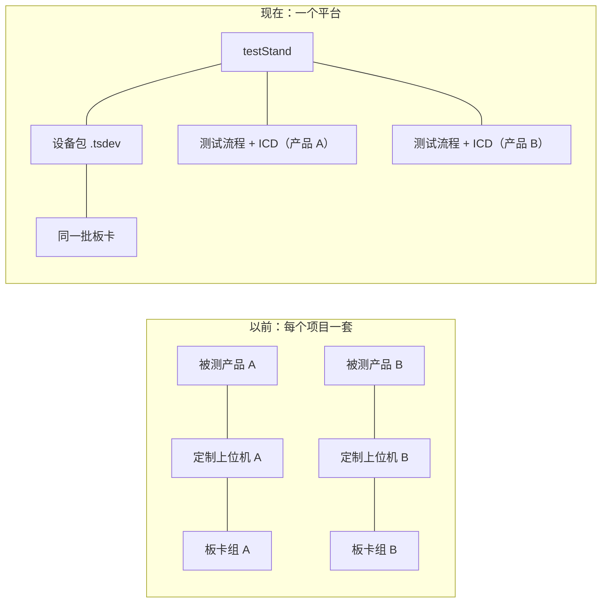

**讲稿**

以前每个被测对象接口不同、选的板卡不同、SDK 不同、测试流程不同，所以每个项目定制一套软件，软件和硬件强耦合，项目冻结后板卡也没法复用。代价是周期长、复用难、改动风险高，接线关系写死在代码里，现场出问题只有写代码的人能修。

testStand 把这件事拆成三份可复用的东西：平台本身；每种测试资源一个设备插件；每个产品一份测试流程和一份协议描述（ICD）。换产品只换流程和 ICD，换板卡只换插件。

---

## 第 3 页　总体架构

**插图**

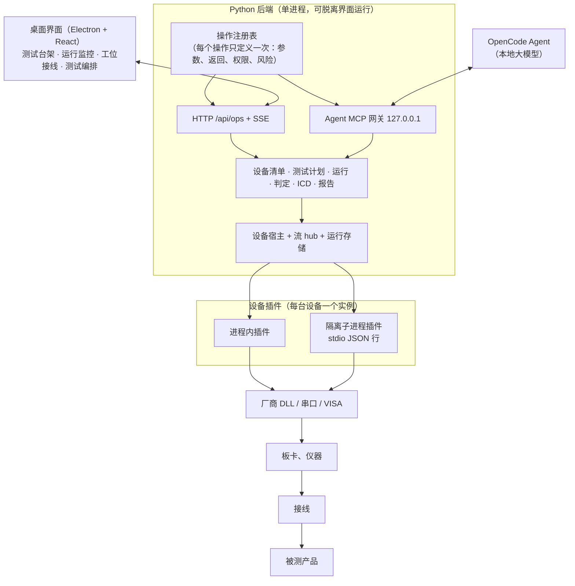

**讲稿**

一台电脑同时跑测试终端并驱动全部测试资源。界面只负责显示；所有业务都在 Python 后端，后端可以不开界面单独运行。

后端最重要的设计是**操作注册表**：每个操作——比如“添加设备”“启动测试”——只定义一次参数、返回、权限和风险等级，然后由它同时生成界面用的 HTTP 接口、AI 用的 MCP 工具和前端的类型定义。所以人能做的操作 AI 都能做，权限、确认、审计走的是同一条路径，不会出现“界面上有、AI 没有”或者“AI 绕过了权限”的情况。

设备以**插件**的形式加载进后端，一台设备一个实例。驱动需要隔离时，插件自己声明在子进程里运行，上层无感。

---

## 第 4 页　设备插件：一个类，四样东西

**插图**：插件包的结构和它对外暴露的四样东西。

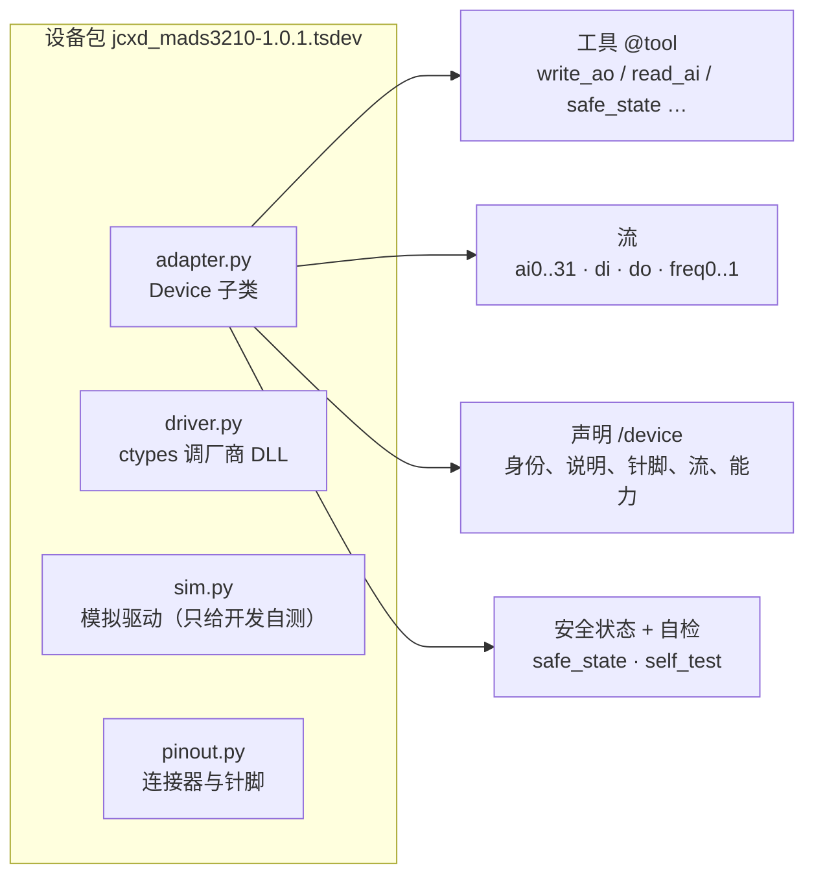

**讲稿**

插件接口是整个平台最核心的约定。写一个插件，就是继承 SDK 的 `Device` 类，它对外只有四样东西：

一是**工具**：用 `@tool` 声明的一个个操作，比如写电压、读输入、闭合继电器；二是**流**：设备上持续发生的数据，比如采样值、串口收发；三是**声明**：型号、说明、针脚表、流清单、能力上限，由 SDK 自动生成，作者不手写 JSON；四是**安全状态和自检**：任何时候都能把输出拉回无害值，并且能自己证明“我和这块卡对得上”。

一个设备包里就是这些：适配器、调厂商 DLL 的驱动、一个行为一致的模拟驱动（只给开发时自测用，产品里没有模拟运行），以及针脚表。

---

## 第 5 页　工具：一次声明，三处使用

**插图**：左边是代码，右边是它生成的三样东西。

```python
@tool(kind="actuate", output=AoResult, safety_action="safe_state",
      effects=("ao_driven",),
      description="Set one AO channel to a static voltage (-10..10 V); ... "
                  "The result is the accepted setting; the card has no output readback.")
def write_ao(self, channel: param(int, "AO channel 0..7", ge=0, le=7),
             volts: param(float, "Voltage in V", ge=-10, le=10)) -> dict:
    ...
```

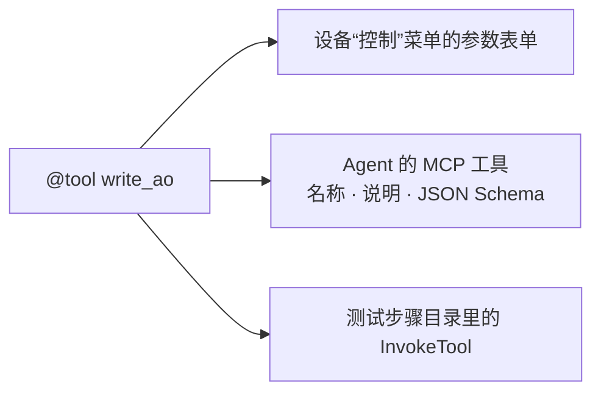

**讲稿**

同一份 `@tool` 声明生成三样东西：操作员在设备卡片上点“控制”看到的参数表单、AI 看到的工具说明和参数 schema、测试编排里可以选的步骤。不写第二份，所以三处永远一致。

参数的范围写在类型里，比如通道 0 到 7、电压正负 10 伏，越界的请求在到达驱动之前就被拒绝，**拒绝，而不是截断**。每个工具的说明至少 80 个字，必须讲清楚它证明什么、不证明什么——比如这张卡没有输出回读，返回的是“驱动接受了这个设定”，不是“测到了这个电压”。

---

## 第 6 页　工具的种类与结果信封

**插图**：两张表。

| kind | 含义 | 失败后能否自动重试 |
|---|---|---|
| `read` | 只读 | 可以 |
| `configure` | 改设置，不产生物理作用 | 仅幂等时 |
| `actuate` | 产生物理作用：出电压、合继电器、发报文 | **禁止**（`never_after_dispatch`） |
| `safe` | 回到安全状态 | 可以 |

```jsonc
{"ok": true, "data": {"channel": 1, "volts": 2.5},
 "meta": {"operationId": "run42.s7.a1",
          "timing": {"start": 1790000000100.2, "end": 1790000000101.9},
          "streamRefs": [{"streamId": "ao1", "fromSeq": 88, "toSeq": 88}]}}
```

**讲稿**

每个工具都声明自己是哪一类。最关键的是 `actuate`：它产生了物理作用，一旦调用已经发出去，**无论超时还是出错，平台都不会自动重发**。因为“没收到回复”不等于“没发生”，重发一次继电器切换或者烧录，可能就是一次事故。结果未知的动作进入核销流程，由人或 AI 拿着证据确认它到底执行了没有。

所有工具返回统一的信封。三个字段特别重要：`operationId` 是这次动作的编号，动作期间产生的所有数据都带着它；`timing.end` 是驱动调用返回的时刻，它是后面判定时间窗口的**锚点**；`streamRefs` 指出这次调用写进了哪些流记录。这三样把“动作”和“证据”连了起来。

---

## 第 7 页　生命周期、隔离与安全状态

**插图**

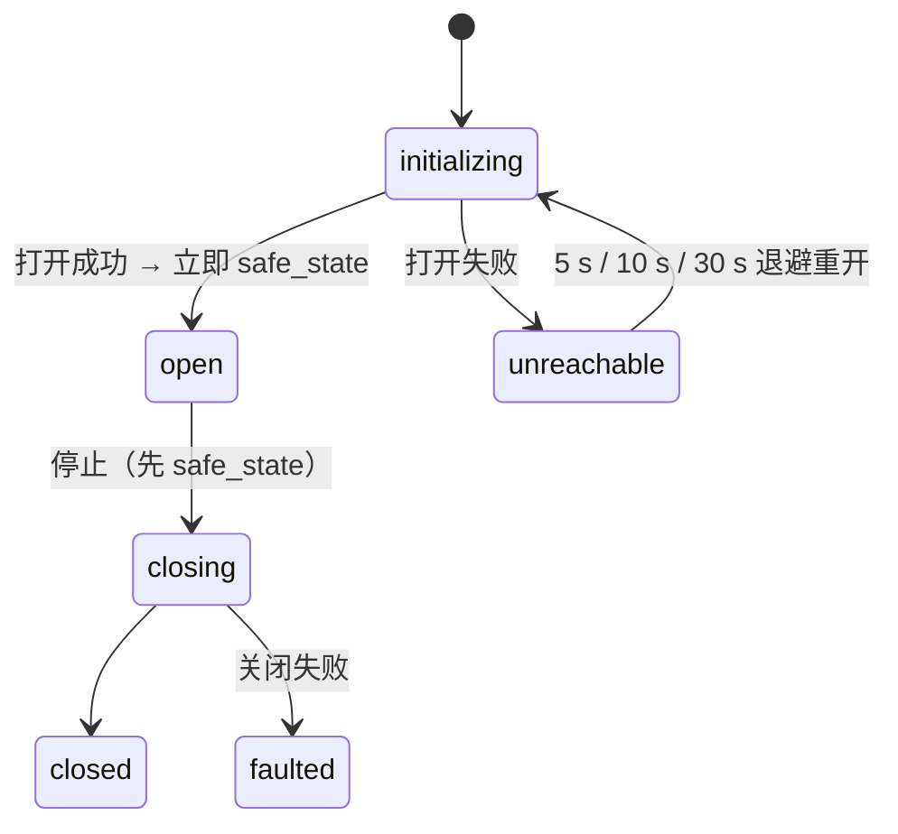

**讲稿**

设备的状态机很简单：只有 `open` 状态接受操作。`safe_state`——所有输出拉回无害值，AO 回 0 伏、DO 拉低、继电器释放、波形停止——在这些时刻一定执行：设备打开或重开之后、关闭之前、测试中止时、软件正常退出时。

驱动加载时会往标准输出打印、可能崩溃、或者要求独占进程的，插件声明 `isolation = "subprocess"`，在独立子进程里跑，父子之间是一行一个 JSON 的协议。子进程崩了只影响这一台设备；后端退出时子进程先执行安全状态再退出。这一层对上面完全透明。

---

## 第 8 页　交付与验证：设备包、自检、现场验收

**插图**：左“添加设备”弹窗（`media-v2/add-device.png`），右“自检”结果（`media-v2/self-test.png`）。

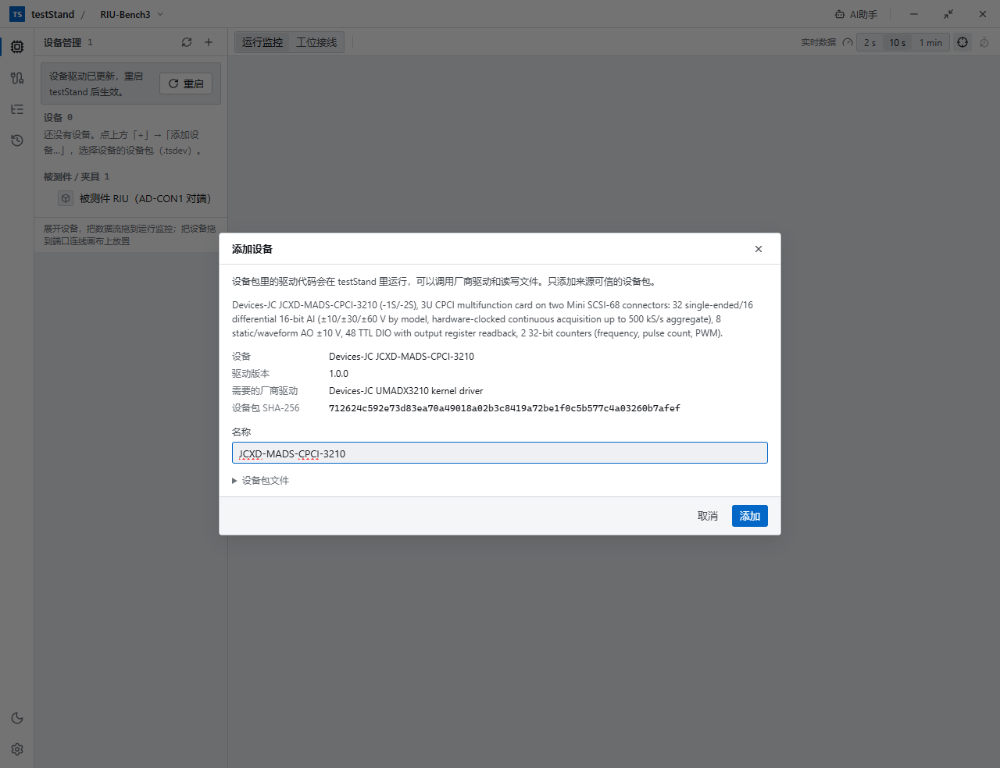

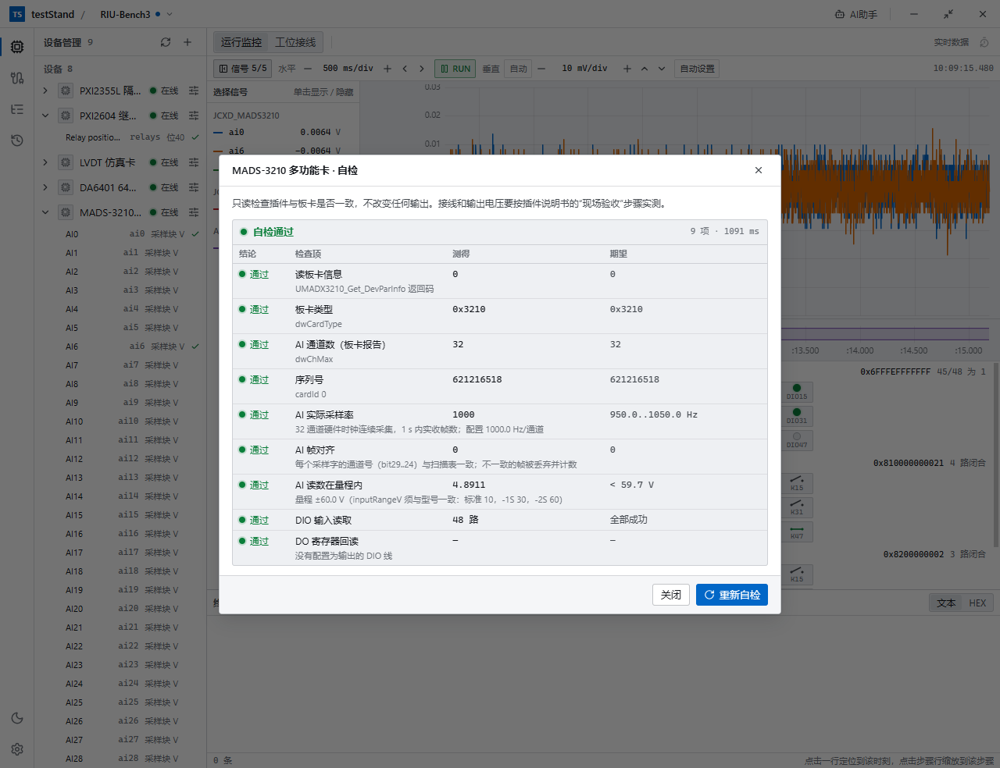


**讲稿**

插件以设备包交付，一个 `.tsdev` 文件。用户点“添加设备”，选文件，弹窗先列出清单：型号、版本、需要预装的厂商驱动、每个文件的 SHA-256。插件代码会在软件里运行，所以必须由人确认后才安装。

我们曾经让软件里的 AI 照着手册自己写插件，结果发现关键问题不在写不写得出来，而在于**用户没法核实它对不对**。所以现在插件由提供方开发、在真实板卡上验收后交付，并且每个插件带两样东西让用户自己验证：

第一是**自检**，在设备的“控制”菜单里，只读，不动任何输出。右边是多功能采集卡的自检：板卡类型、序列号、通道数、32 路一起按 1 kHz 连续采集时 1 秒内实收的采样率、每个采样字的通道号是否和扫描表对齐、读数是否在量程内。它证明插件和这块卡对得上。

第二是**现场验收**：每个插件说明书里写着用万用表或者一根回环线就能做的步骤，接哪几个针脚、调哪个工具、期望读数和容差。它证明接线、输出电压、触点通断。自检加现场验收，用户不看代码也能确认插件可信。

这台台架上的 7 种板卡——多功能采集、64 路模拟输出、两张继电器卡、隔离数字量、40 路开关、LVDT 仿真、8 路串口——都按这个流程交付了。

---

## 第 9 页　数据流：和工具并列的第二条通道

**插图**

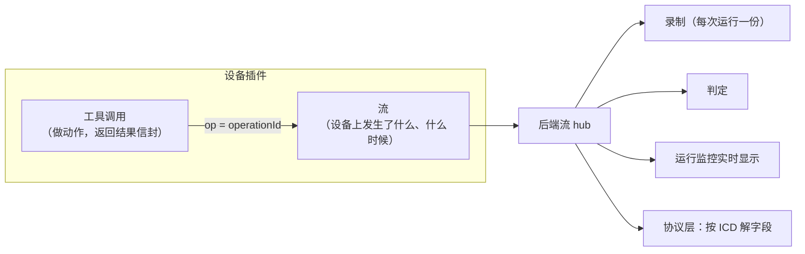

**讲稿**

工具回答“做了什么”，流回答“设备上发生了什么、什么时候发生的”。两者是并列的两条通道。

为什么不能只靠工具的返回值？因为测试里大量的证据不是“调用的返回值”，而是一段时间里的数据：输出电压设定后 100 毫秒内的平均值、发出指令后 1 秒内串口回了什么、整个测试期间某路电压有没有越限。这些都要求数据有可信的时间戳、能确认没有漏、能和动作关联起来。

所以流有五个承诺：完整性可知、时间可信、可续读、能判定“没有发生”、动作可关联。

---

## 第 10 页　六种流

**插图**

| 类型 | 一条记录 | 典型来源 | 电平 / 事件 |
|---|---|---|---|
| `scalar` | `{v}` 一个数 | 测量值、设定值 | 电平 |
| `bits` | `{mask}` 一组开关量 | DI、DO、继电器 | 电平 |
| `bytes` | `{dir: rx/tx/mark, data}` | 串口 | 事件 |
| `frames` | `{dir, id, data}` 带身份的报文 | CAN、429、1553B、1394 | 事件 |
| `block` | `{t0, dt, samples[]}` 一段等间隔采样 | 硬件定时连续采集 | 事件 |
| `blob` | `{ref}` 大对象 | 示波器截图、波形文件 | 事件 |

所有记录都带：`seq`（序号，无空洞）、`t`（时间，毫秒）、`op`（产生它时正在执行的动作，可选）。流声明还带 `unit`、`label`、`kind`（`measured` 测得值 / `setpoint` 设定值影子）。

**讲稿**

测试资源上能发生的事，归纳下来就是六种。每条记录都有序号、时间戳和可选的动作编号。

这里有一个对证据很关键的字段 `kind`：`measured` 是测出来的，`setpoint` 是“软件记下的设定值”。比如 64 路模拟输出卡没有回读，它的流只能是设定值影子。平台规定设定值影子**只能显示，不能作为判定证据**，测试流程里拿它做判定，编译时就会被拒绝。要证明输出对了，必须用独立的测量，比如用采集卡去测。

---

## 第 11 页　环形缓冲、按需采样与水位线

**插图**

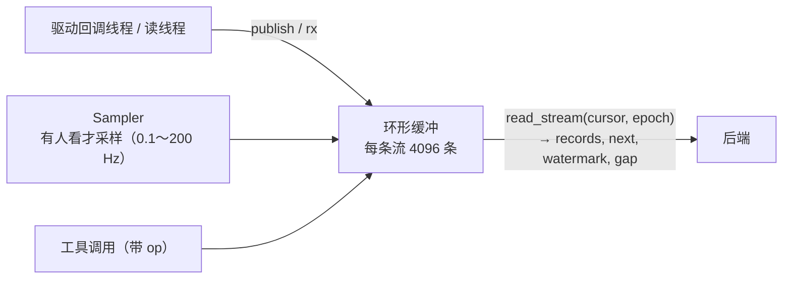

```text
时间 ─────────────────────────────────────────────►
记录    ●   ●  ●    ●     ●        ●
                              ▲ watermark
承诺：所有 t ≤ watermark 的记录都已读到，或已经以 gap 报告
```

**讲稿**

每条流在插件里是一个环形缓冲。轮询类的采样只在有人观看时才运行，没人看就不占驱动。后端用游标续读，游标里带一个 epoch，设备重开后 epoch 变化，读取方马上知道中间断过。缓冲被覆盖了，会明确报一个 gap，而不是悄悄丢数据。

最重要的概念是**水位线**。它的承诺是：所有时间戳小于等于水位线的记录，要么已经读到了，要么已经以缺口报告了。有了它，平台才能回答“这段时间里**没有**收到某条报文”——这在测试里非常常见，比如“断电后 1 秒内不应再有心跳”。如果驱动出错、采样停了，水位线就停止推进，判定等不到水位线，结果是“证据不足”，而不是错判成“没有发生”。

---

## 第 12 页　硬件定时采集：块流

**插图**：新旧对比。

| | 旧插件（AI 编写） | 新插件 |
|---|---|---|
| 采样方式 | 软件单次采样，后台轮询 | 板卡硬件时钟连续采集 |
| 有效采样率 | 5 Hz | 32 通道 × 1 kHz（实测 16 通道 × 5 kHz 连续无缺口） |
| 记录形态 | 每次一个 `scalar` | 每 50 ms 一块 `block {t0, dt, samples[]}` |
| 完整性 | 采样之间的数据看不到 | 每个采样字核对通道号，错帧丢弃并计数 |

```text
板卡 FIFO ──每 20 ms 取整帧──► 插件 ──按通道拆成块──► ai0..ai31 块流
                                        t0 = 第一个采样的硬件时间, dt = 1 ms
```

**讲稿**

这是这次改动里最能说明问题的例子。之前的采集卡插件用软件单次采样，默认 5 赫兹，示波器上看到的波形完全失真。问题不在硬件，在插件的写法。

新插件打开设备就让板卡按自己的时钟连续采集，后台线程每 20 毫秒把整帧数据取出来，按通道拆成块，每块带第一个采样的时间 `t0` 和采样间隔 `dt`。这样示波器、判定拿到的是板卡采到的每一个点。每个采样字里有通道号，插件逐帧核对，对不上的帧丢弃并计数，这一项也进了自检。

做这件事时还查出 SDK 的一个时间戳缺陷：块的 `t0` 会被水位线往后推，造成块与块之间出现假缺口。现在 `t` 只用于排序，`t0` 保留硬件时间，块与块之间严丝合缝。

---

## 第 13 页　协议层：按 ICD 把字节解成字段

**插图**

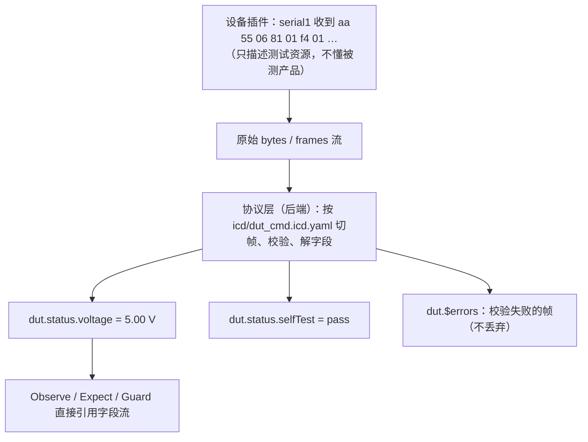

```yaml
framing: {kind: header_length, header: "AA 55", lengthField: {offset: 2, size: 1}}
checksum: {algorithm: crc16_modbus, range: {from: 2, to: -2}}
messages:
  - name: status
    match: {offset: 3, value: 0x81}
    fields:
      - {name: voltage, offset: 5, type: i16, endian: little, scale: 0.01, unit: V}
```

**讲稿**

插件只描述测试资源，比如“串口 1 收到了这些字节”，**禁止**内置任何被测产品的协议知识。被测产品的协议放在后端的协议层，用一份 ICD 文件描述：怎么切帧、用哪种校验、每条消息有哪些字段、怎么换算单位。

解出来的字段本身也是一条流，比如 `dut.status.voltage`，测试步骤可以直接对它做判定。校验失败的帧不丢，进错误流便于诊断。录制只存原始字节，报告里记 ICD 的哈希，事后可以用同一份 ICD 重新解码、重新判定。换产品只换 ICD，不改插件，也不改平台。

---

## 第 14 页　运行监控：像用一台示波器

**插图**：`media-v2/scope.png`。

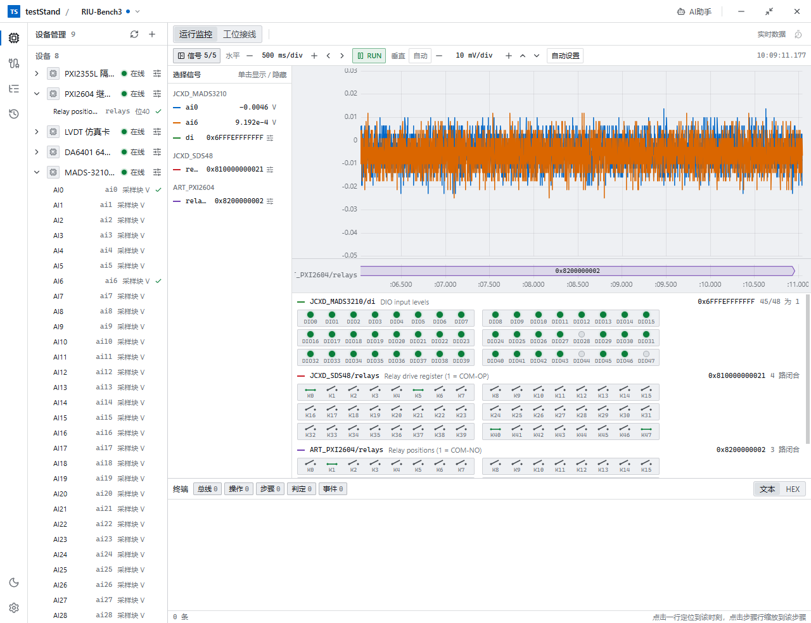

| 区域 | 操作 |
|---|---|
| 水平 | 时基 1-2-5 档（10 ms/div～60 s/div，10 格）· 左右移一格 · RUN / STOP |
| 垂直 | 自动 · V/div 1-2-5 档 · 上下移一格（8 格）· 自动设置 |
| 信号 | 左侧“选择信号”列表可折叠；折叠后工具栏显示图例和读数 |
| 数字量 | 每位一个指示灯，继电器画成触点，按 8 位分组 |

**讲稿**

运行监控就是一台虚拟示波器，操作和台式示波器一样：水平方向调时基、左右移位、RUN 和 STOP；垂直方向可以自动，也可以手动调每格多少伏、上下移位，或者按“自动设置”让它按屏幕上的波形自己选档。STOP 会冻结当前画面，可以慢慢看、左右翻。

截图里上半部分是两路模拟输入，每格 10 毫伏，看得清本底噪声；下面是数字量面板：48 路数字输入哪几路为 0，两张继电器卡哪几路闭合，一眼就能看出来。左侧的信号列表可以收起来，把地方让给波形。

这块面板只看不控。控制设备只有两条路：操作员用设备的“控制”菜单，测试流程用 InvokeTool 步骤。监控、接线、测试流程互不引用，由 AI 在每次运行前检查三者一致。

---

## 第 15 页　测试编排：激励—等待—测量—判定

**插图**


```jsonc
{"schemaVersion": 2,
 "parameters": {…}, "bindings": {…}, "protocolBindings": […],
 "stopOnFail": true,
 "regions": {"prepare": […], "test": [Feature, Feature, …], "cleanup": […]}}
```

**讲稿**

所有功能测试归纳起来都是同一个范式：激励、等待、测量、判定。测试流程是结构化数据，不是代码：可以校验、比较、复用，AI 可以写，人可以一眼检查。

一个项目只有一个测试流程，分三个区域：准备、测试、清理。**清理区不管通过、失败还是中止都会执行**，保证设备最后回到安全状态。测试区顶层是功能组（Feature），每组测被测对象的一项功能，组与组之间互不依赖，运行时可以只勾选其中几组。

---

## 第 16 页　步骤目录

**插图**

| 类别 | 步骤 |
|---|---|
| 流程控制 | Sequence、Group、Feature、Parallel、If、Repeat、ForEach、Retry |
| 数据 | SetVariable、Evaluate、Delay |
| 硬件（唯一接触硬件的步骤） | InvokeTool：设备 + 工具 + 参数 + 超时 + 错误策略 + 锚点 |
| 观测与判定 | Observe（窗口统计）、Expect（等匹配记录）、Guard（全程监视）、ManualCheck（人工判定）、PublishResult |

**讲稿**

步骤分四类。硬件的差异全部收进 InvokeTool 这一种步骤里，其余步骤都和硬件无关。

判定类有三个核心步骤：**Observe** 在一个时间窗口里对一条流做统计再断言，比如“设定后 20 到 120 毫秒的平均值在 0.99 到 1.01 伏之间”，统计量有均值、最小最大、峰峰值、有效值、标准差，还有频率、周期、占空比、上升下降时间、稳定时间；**Expect** 等一条匹配的记录，比如发指令后 1 秒内串口回 `OK`，还能把匹配到的内容捕获下来给后面的步骤用；**Guard** 包住一组子步骤，在它们执行期间全程监视某条流，越限就失败或中止。

有一条编译检查值得一提：Retry **不允许包住结果可能未知的动作**，原因和前面讲的一样——不重发物理动作。

---

## 第 17 页　锚点与时间窗口

**插图**

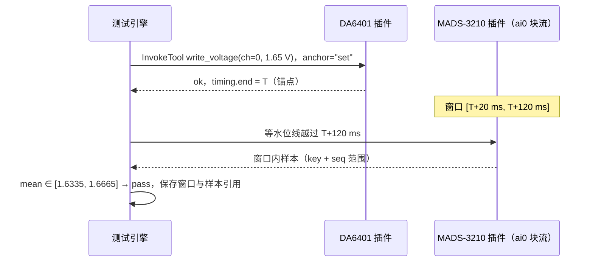

**讲稿**

判定的时间从哪里算？从**锚点**算。锚点就是激励动作的 `timing.end`——驱动调用返回的那一刻，它和流记录用的是同一个时钟，不需要对时。

Observe 的窗口写成“相对锚点的起止毫秒”。判定时引擎会等水位线越过窗口末尾，保证窗口里的数据已经全部到齐，再取样本统计。每个判定都保存窗口参数和样本引用，报告可以离线重新判定，结果必须一致。

---

## 第 18 页　一个完整的例子

**插图**：用 64 路模拟输出卡给采集卡打电压，验证采集精度。

```yaml
regions:
  prepare:
    - {id: zero, type: InvokeTool, hardwareId: JCXD_DA6401_CARD, toolName: da6401_set_all, arguments: {volts: 0}}
  test:
    - id: accuracy
      type: Feature
      name: 采集精度
      children:
        - id: sweep
          type: ForEach
          itemsExpression: "[-5.0, 0.0, 1.65, 5.0]"
          children:
            - {id: set, type: InvokeTool, hardwareId: JCXD_DA6401_CARD,
               toolName: da6401_write_voltage, arguments: {channel: 0, volts: {expression: item}}, anchor: set}
            - id: level
              type: Observe
              hardwareId: JCXD_MADS3210_CARD
              streamId: ai0
              window: {anchor: set, startMs: 20, endMs: 120}
              assertions: [{metric: mean, op: within, value: {expression: item}, tolerance: 0.02}]
  cleanup:
    - {id: safe, type: InvokeTool, hardwareId: JCXD_DA6401_CARD, toolName: da6401_safe_state}
```

**讲稿**

这是一个真实台架上的例子（参数里的 `{expression: item}` 取 ForEach 当前项，表达式是 CEL 的安全子集）：准备区把 64 路输出全部清零；测试区一个功能组“采集精度”，遍历四个电压，每次设好电压，在 20 到 120 毫秒的窗口里看采集卡第 0 路的平均值，容差 20 毫伏；清理区回安全状态。

注意证据的来源：设定值来自模拟输出卡，判定用的是采集卡的**独立测量**，这是 T1 级证据。如果有人把输出卡自己的设定值影子拿来判定，编译就会报错。

---

## 第 19 页　判定结果与证据等级

**插图**

| 结论 | 说明 |
|---|---|
| pass / fail | 证据充分，判定明确 |
| inconclusive | `watermark_timeout` 水位线没越过窗口 · `gap` 窗口内有缺口 · `insufficient_evidence` 样本不足 · `clock_uncertainty` 锚点不确定度让窗口为空 · `operator_undecided` 人工无法判断 |

| 证据等级 | 内容 |
|---|---|
| T1 | 独立测量：采集卡、仪器直接测被测对象 |
| T2 / T3 | 仪器自测 / 仪器内部精密测量 |
| P | 被测产品协议回报 |
| M | 人工判定 |
| S | 设定值影子：**只能显示，不能判定** |

**讲稿**

除了通过和失败，平台有第三种结论：**不确定**。证据不足时明确说不确定，并给出原因，而不是猜一个结果。这是“未知就是未知”这条原则在判定上的体现。

每个判定还标记证据等级。报告里一眼能看出哪些结论来自独立测量，哪些来自被测产品自己的回报，哪些是人工判断。

---

## 第 20 页　未知结果与核销

**插图**

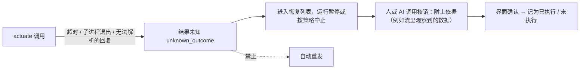

**讲稿**

最后一条语义规则：物理动作结果未知时，绝不自动重发。它进入恢复列表，由人或 AI 去找证据——比如流里有没有出现那个电压、那条报文——然后核销为“已执行”或“未执行”，核销本身需要在界面上确认。

---

## 第 21 页　AI Agent：大模型 + 工具箱的循环

**插图**

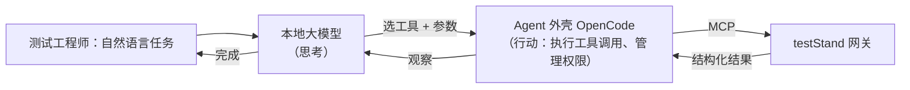

**讲稿**

AI 助手由两部分组成：大模型负责思考，输入文字、输出文字；Agent 外壳负责给模型组装上下文、执行它选中的工具、管理权限。两者组成“思考—行动—观察”的循环，每一步都看到真实的执行结果再决定下一步，出了问题能自己发现和调整。

模型跑在本地，经 OpenAI 兼容接口接入，不联网。Agent 只通过 testStand 的 MCP 网关调用工具，不直接碰设备插件。

---

## 第 22 页　工具从哪里来：同一个操作注册表

**插图**

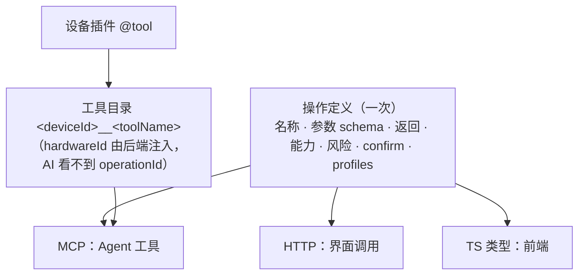

**讲稿**

AI 的工具有两个来源：平台工具，来自操作注册表，和界面用的是同一份定义；设备工具，来自插件的 `@tool`，对外名字是“设备编号 + 工具名”，`hardwareId` 由后端注入，`operationId` 也由后端注入，AI 不需要也看不到。

所以 AI 拿到的工具说明和参数校验，和操作员在界面上看到的完全一样；权限、确认和审计也走同一条中间件。

---

## 第 23 页　工作模式：给本地模型做减法

**插图**

| 模式 | 典型任务 | 提供的工具 |
|---|---|---|
| `plan` | 编写测试流程、ICD | 项目与设备清单、`get_hardware_definition`、步骤目录、流程的增量编辑与校验、ICD 校验与试解码、`monitor_streams` / `update_monitor`、`request_wiring` |
| `run` | 运行、分析、核销 | 启动 / 等待运行、读结果、`testing_read_run_io`、`testing_read_run_messages`、核销；**不展开设备工具** |
| `explore` | 手动调试设备 | 目标设备的工具（按需展开）、`observe_stream`、`expect_stream` |

```text
list_device_tools(hardwareId)   → 只看这台设备有哪些工具
enable_device_tools(hardwareId) → 只展开正在调试的这一台
```

**讲稿**

本地模型的能力有限，工具一多就容易选错。所以网关按**模式**只提供一个子集，每个操作属于哪些模式写在注册表里，不在网关另写清单。

设备工具默认不平铺：一个台架上 8 台设备、上百个工具，全部摊给模型只会添乱。AI 先用 `list_device_tools` 看某台设备有什么，再用 `enable_device_tools` 只展开正在调试的那一台。运行模式下根本不提供设备工具：动作只能通过测试流程执行，每一步都有锚点、判定和记录。

---

## 第 24 页　安全边界与人工确认

**插图**

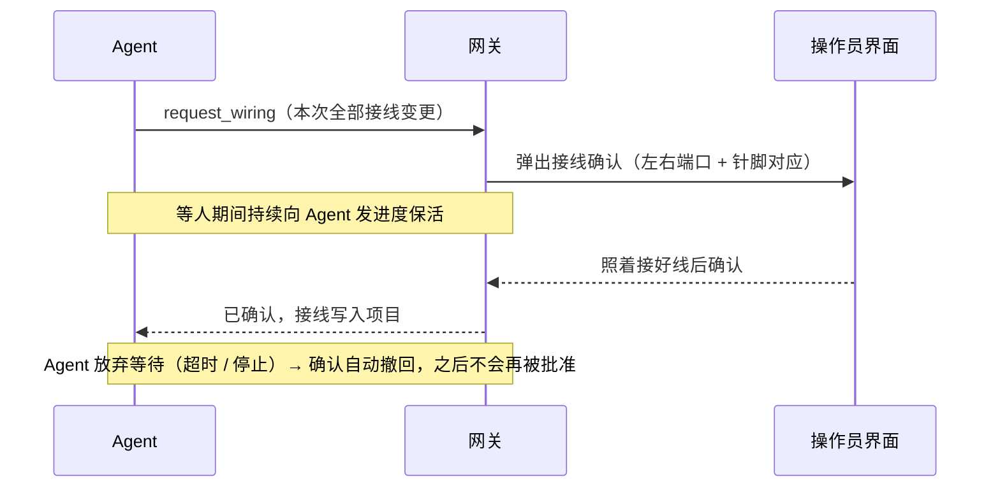

| 规则 | 做法 |
|---|---|
| 能力授权 | 每个工具绑定一项能力（读硬件、执行工具、管理设备、运行测试），在设置里授权 |
| 高风险确认 | 核销、删除设备、删除计划、改接线、添加设备：界面确认，300 s 无应答视为拒绝 |
| 参数范围 | 插件在工具内做范围检查，平台不得绕过 |
| 未知结果 | 不能重发，只能核销 |
| 离线与隔离 | 无网页工具，shell 联网命令被拒；读不到 testStand 安装目录、源码、插件与用户数据；密钥不进 Agent 的环境变量 |

**讲稿**

AI 能做人能做的几乎所有事，但有几条边界。第一，**物理世界和软件里的接线必须一致**，这一点只能由人保证：AI 规划接线后，一次提交全部变更，弹窗给操作员，照着接好再确认；等待期间 AI 不做别的。第二，高风险操作需要界面确认；AI 放弃等待时，这个确认会被撤回，不会在之后被意外批准。第三，AI 不联网、读不到软件自己的源码和插件目录，也拿不到密钥。

---

## 第 25 页　AI 怎么完成一个测试任务

**插图**

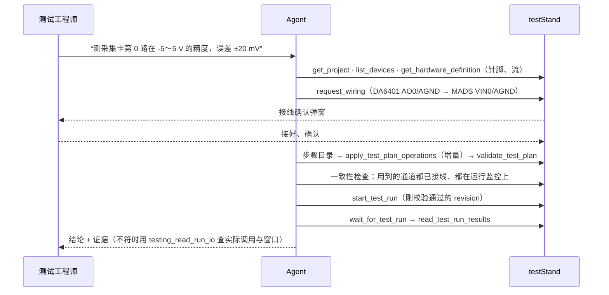

**讲稿**

把前面的串起来，一个任务是这样完成的：AI 先读工程状态——有哪些设备、针脚、流、已有的接线和流程；规划接线并请人确认；从步骤目录增量编辑测试流程，每次修改后校验；运行前做一次一致性检查，确认流程用到的每个通道都接了线、都在运行监控上；然后启动运行、增量等待、读取真实结果，用实际数据说明结论，清楚区分设定值和测量值。结果不对，它会查这一步实际下发了什么调用、判定窗口里是什么数据，再决定改流程还是改接线。

AI 给出的始终是可检查的产物：结构化的流程、确认过的接线、带证据的判定。人负责最终放行。

---

## 第 26 页　台架演示

**插图**：演示路线。


**讲稿**

现场演示按这条路线走：添加 7 种板卡的设备包，每台设备做一次自检；把采集卡的模拟输入和几路数字量拖到运行监控上，用示波器的时基、自动设置和 STOP 看一下真实信号；然后让 AI 规划接线、编排流程、运行，最后在结果表、示波器和控制台上回放这次运行，三者在同一条时间轴上联动。

---

## 第 27 页　总结

**插图**：四个关键词。

| 设计 | 一句话 |
|---|---|
| 插件接口 | 一个类：工具 + 流 + 声明 + 安全状态与自检；一次声明三处使用 |
| 数据流 | 有序号、有时间、有水位线、能关联动作；能判定“没有发生” |
| 测试编排 | 激励—等待—测量—判定；锚点 + 窗口；证据不足就说不确定；不重发物理动作 |
| AI 工具调用 | 同一个操作注册表；按模式做减法；人确认接线与高风险操作 |

**讲稿**

总结一下：插件接口让任何测试资源都能以统一的方式接入，并且让用户自己能验证；数据流让每一个判定都有可追溯的证据；测试编排把测试逻辑变成可校验的数据；AI 工具调用让这一切能用自然语言驱动，同时守住物理安全和人的最终决定权。

以上就是我的汇报，谢谢大家。
