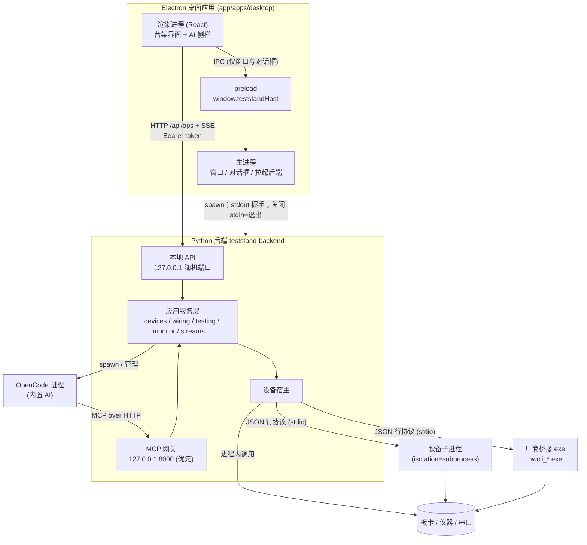
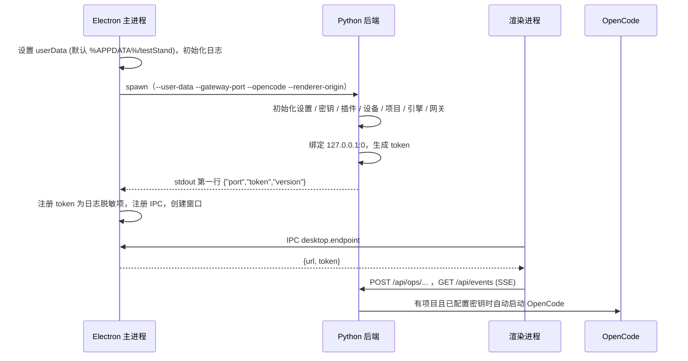
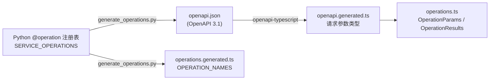
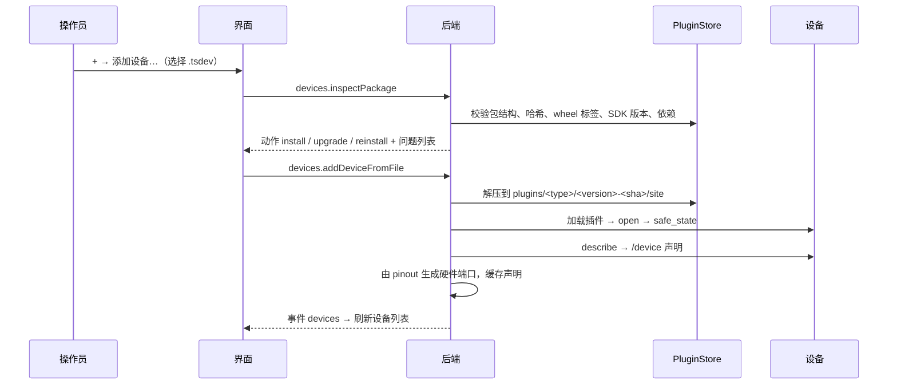
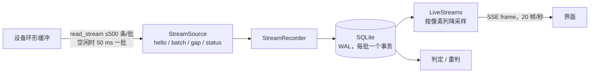
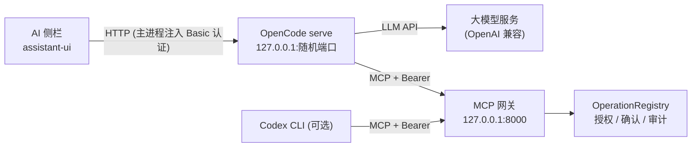
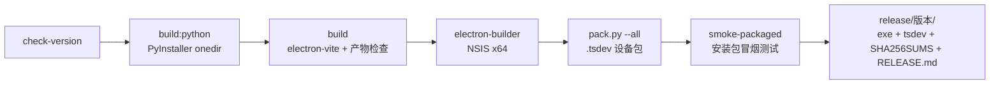

# testStand 技术架构说明

> 适用版本：0.2.0（含 CHANGELOG“未发布”部分）。本文按“技术栈 → 架构 → 通信 → 数据 → 流程 → 引擎 → 插件 → 实时数据 → 前端 → AI → 安全 → 工程化 → 发布 → 扩展 → 现状”的顺序，从外到内说明 testStand 的技术实现。文中路径均相对仓库根目录。

---

## 目录

1. [项目概述](#1-项目概述)
2. [技术栈](#2-技术栈)
3. [系统架构](#3-系统架构)
4. [启动与生命周期](#4-启动与生命周期)
5. [接口与通信协议](#5-接口与通信协议)
6. [数据模型与存储](#6-数据模型与存储)
7. [核心业务流程](#7-核心业务流程)
8. [测试引擎](#8-测试引擎)
9. [设备插件体系](#9-设备插件体系)
10. [实时数据流与性能](#10-实时数据流与性能)
11. [前端架构](#11-前端架构)
12. [AI Agent 集成](#12-ai-agent-集成)
13. [安全与可靠性](#13-安全与可靠性)
14. [工程化与质量保障](#14-工程化与质量保障)
15. [构建、打包与发布](#15-构建打包与发布)
16. [扩展点](#16-扩展点)
17. [现状与已知问题](#17-现状与已知问题)

---

## 1. 项目概述

testStand 是**单机测试台架软件**：测试终端和全部测试资源（板卡、仪器、串口等）运行在同一台 Windows 电脑上。它把以下环节放在一个桌面应用里完成：

```
设备管理 → 工位接线 → 测试编排 → 执行 → 实时监控 → 判定 → 运行记录 / 回放 / 重判
```

设计上的几个基本取舍：

| 取舍 | 做法 | 理由 |
|---|---|---|
| 界面与业务分离 | Electron 只做界面和窗口；全部业务逻辑在 Python 后端 | 硬件驱动生态在 Python/C；构建脚本会检查主进程里不得出现业务类 |
| 设备即插件 | 每种板卡是一个插件，以 `.tsdev` 设备包交付，发布版不内置驱动 | 主程序与硬件解耦，新增设备不改主程序 |
| 证据可追溯 | 运行时把所有数据流录进 SQLite，判定可以离线重算 | 测试结论必须能被复核 |
| AI 受控 | 内置 Agent 通过 MCP 网关访问台架，运行在沙箱里，关键操作需人工确认 | AI 能提效，但不能越权操作硬件 |

---

## 2. 技术栈

### 2.1 总览

| 层 | 技术 | 版本 | 用途 |
|---|---|---|---|
| 桌面外壳 | Electron | ^36.2（锁定 36.9.5） | 窗口、进程管理、原生对话框 |
| 构建 | electron-vite + Vite | ^3.1 / ^6.3 | 分别构建 main / preload / renderer |
| UI 框架 | React | 19 | 渲染进程 |
| 语言 | TypeScript | ^5.8（锁定 5.9.3） | 前端与契约包 |
| 样式 | Tailwind CSS 4 + Radix UI | ^4.3 / ^1.6 | 设计系统（`src/renderer/ui/`） |
| 服务端状态 | TanStack Query | ^5.76 | 请求缓存、事件驱动失效 |
| 后端语言 | Python | 3.11（`>=3.11,<3.12`） | 业务后端、设备 SDK |
| 后端服务 | Starlette + uvicorn | 1.6.0 / 0.52.4 | 本地 HTTP API 与 MCP 网关 |
| 数据校验 | pydantic + jsonschema；前端 zod | 2.13.5 / 4.26.0；^3.24 | 请求模型、工具参数校验、表单 |
| 本地存储 | JSON 文件 + SQLite（WAL） | — | 项目、设置、运行日志、录制 |
| AI | OpenCode + MCP | opencode 1.18.15，mcp 1.29.1 | 内置智能体与工具协议 |
| 包管理 | pnpm（前端）、uv（Python） | pnpm 10.15.0 | 工作区、锁文件 |
| 打包 | electron-builder（NSIS）+ PyInstaller | 26.15.3 / 6.22.2 | Windows 安装程序 |

### 2.2 前端主要库及用途

| 库 | 用途 | 主要位置 |
|---|---|---|
| dockview-react | 运行监控的可停靠面板工作台（拆分、标签页、浮动、弹出窗口） | `features/monitor/MonitorPane.tsx` |
| uPlot | 示波器曲线（高性能 Canvas 绘图，按需懒加载） | `features/streams/StreamScope.tsx` |
| @xyflow/react | “端口连线”画布 | `features/wiring/WiringCanvas.tsx` |
| @xterm/xterm | 串口 / 总线终端 | `features/streams/BusTerminal.tsx` |
| @tanstack/react-virtual | 总线跟踪表格虚拟滚动 | `features/monitor/panels/TracePanel.tsx` |
| @dnd-kit | 测试编排拖拽（组件库 → 步骤树、步骤排序） | `features/testing/*` |
| react-hook-form + zod | 设备 / 硬件 / 模型设置表单 | `features/devices/editors/*` |
| @assistant-ui/react(-opencode) | AI 助手侧栏（对接 OpenCode，带补丁） | `features/agent/*` |
| @pierre/diffs | AI 修改的补丁展示 | `features/agent/tools/apply-patch-tool.tsx` |
| electron-log | 主进程日志（自动脱敏） | `main/logger.ts` |

### 2.3 后端主要依赖及用途

| 依赖 | 用途 |
|---|---|
| `mcp` | MCP 网关（StreamableHTTP 传输） |
| `pydantic` | 自动生成的操作请求模型、ICD 模型、设备工具参数模型 |
| `jsonschema` | 设备工具参数 / 结果校验（Draft 7 / 2020-12） |
| `starlette` / `uvicorn` | ASGI 服务（本地 API 与网关共用） |
| `httpx` | OpenCode 健康检查、Codex 网关探测 |
| `ruamel.yaml` | 测试计划 YAML、ICD YAML 解析 |
| `keyring` | 把 LLM 密钥、网关令牌存进 Windows 凭据管理器 |
| `ada-url` | URL 校验 |
| `teststand-device-sdk` | 设备插件 SDK（仓库内 `devices/sdk`） |

### 2.4 选型理由

- **Electron**：桌面窗口、无边框自定义标题栏、多窗口（监控面板可弹到第二块屏）和本地文件对话框都有成熟支持；前端生态（dockview、uPlot、xyflow）可直接复用。
- **Python 后端**：厂商驱动大多是 C DLL，用 `ctypes` 可以直接调用；数据处理、YAML、SQLite 都有标准库或成熟库；PyInstaller 打包后用户无需安装 Python。
- **HTTP + SSE 而不是 Electron IPC 传业务**：后端独立于 Electron，可以被测试、被 AI 网关复用；SSE 足以满足服务端推送，且能断线续传。
- **SQLite**：单文件、事务、WAL 支持一写多读，适合“边录边看”的运行录制。

---

## 3. 系统架构

### 3.1 进程模型



关键点：

- **渲染进程直接访问后端**：业务调用不经过主进程，主进程只负责窗口、原生对话框，以及把后端地址和令牌交给渲染进程。
- **后端是唯一的业务中心**：桌面界面和 AI 网关都调用同一套应用服务，权限按调用方区分（见 §13）。
- **设备可以隔离运行**：会向 stdout 乱打日志或容易崩溃的驱动，放到子进程里运行；子进程崩溃不会拖垮后端。

### 3.2 后端分层

后端包 `app/python/src/teststand_backend`，分层由 import-linter 在 `pyproject.toml` 中强制：

```
接入层     host（HTTP API、进程宿主、OpenCode/Codex）、mcp_gateway
            ↓  （下层不得 import 接入层）
应用层     application（操作注册、授权、确认、执行协调、各命名空间服务）
            ↓
领域层     testing.compiler / interpreter / expression / models、streams.judge、protocol
            （纯逻辑，不做 I/O）
            ↓
资源层     devices.plugin_transport、streams.source / clock / recorder、storage
            （不依赖业务）
契约       contracts（不依赖服务内任何模块）
```

| 子包 | 职责 |
|---|---|
| `host` | 进程入口、握手、本地 HTTP API、SSE 事件总线、设置、OpenCode / Codex 集成 |
| `mcp_gateway` | 面向 AI 的 MCP 服务：工具注册、会话、等待人工确认、结果脱敏 |
| `application` | 操作注册与中间件（校验 / 授权 / 确认 / 幂等 / 审计）、执行协调（设备互斥）、各命名空间服务 |
| `contracts` | 线上（wire）契约：校验 DSL、`@operation` 装饰器、OpenAPI 生成、错误模型 |
| `devices` | 设备包安装、插件加载与传输、设备实例与硬件定义存储、工具目录 |
| `wiring` | 接线任务（人工确认）、接线变更日志、接线校验 |
| `testing` | 测试计划存储、绑定、校验、编译、解释执行、日志、时间线、重判 |
| `streams` | 数据流读取、录制（SQLite）、实时视图、判定函数 |
| `protocol` | 被测件（DUT）协议层：ICD 模型、分帧、编解码、校验和 |
| `projects` | 项目文件读写、最近项目、ICD 库 |
| `storage` | 原子写文件、设置、密钥、审计日志 |
| `workspace` | 给 AI 用的参考资料库、受限路径解析 |

### 3.3 仓库目录

| 路径 | 内容 |
|---|---|
| `app/apps/desktop` | Electron + React 桌面应用（`src/main`、`src/preload`、`src/renderer`、`src/shared`、`e2e`） |
| `app/packages/contracts` | 前后端共享的 TypeScript 契约（含自动生成文件） |
| `app/python` | Python 后端（`src`、`tests`、`scripts`、`backend.spec`） |
| `app/scripts` | 构建、校验、发布脚本 |
| `app/patches` | pnpm 依赖补丁 |
| `devices/sdk` | 设备插件 SDK `teststand_device_sdk` |
| `devices/adapters` | 12 个设备适配器 |
| `devices/native` | 厂商 SDK 的 C++ 桥接程序 `hwcli_*.cpp` |
| `devices/pack.py` | 生成 `.tsdev` 设备包 |
| `skill/` | 编写设备插件的 Agent 技能 |

---

## 4. 启动与生命周期

### 4.1 启动时序



主进程侧（`app/apps/desktop/src/main/python-runtime.ts`）：

- **后端可执行文件**：优先用环境变量 `TESTSTAND_BACKEND_EXECUTABLE`；打包版是 `resources/backend/teststand-backend.exe`；开发版是 `python/.venv/Scripts/python.exe -u -m teststand_backend.host`。
- **环境**：追加 `PYTHONUTF8=1`、`PYTHONUNBUFFERED=1`，隐藏控制台窗口，`shell:false`。
- **握手**：读取 stdout 第一行 JSON，要求含数字 `port` 与字符串 `token`；60 秒超时，超时则关闭 stdin 并结束进程。之后的 stdout 记为 info 日志，stderr 记为 warn 日志。

后端侧（`teststand_backend/host/__main__.py`、`runtime.py`）：

- **参数**：`--user-data`（必填）、`--gateway-port`（默认 8000）、`--opencode`、`--renderer-origin`（可多次，用于 CORS）、`--integration-test-mode`。网关测试令牌只能从环境变量 `TESTSTAND_GATEWAY_TEST_TOKEN` 传入，因为命令行对本机所有用户可见。
- **端口与令牌**：`socket.bind(("127.0.0.1", 0))` 取随机端口；令牌为 `secrets.token_urlsafe(32)`，每次启动重新生成。
- **日志**：一律写 stderr（WARNING 级），保证 stdout 只承载握手这一行。
- **初始化顺序**：设置与密钥 → 插件库（必须先于任何设备类型的 import）→ 设备存储与服务 → 项目、硬件目录、接线、执行协调 → 测试步骤插件、工具解析器、计划存储、数据流 → 实时流（启动时清理残留 SQLite）→ 测试引擎、应用门面 → OpenCode / Codex / Agent 服务 → 操作注册表（带审计和确认）→ MCP 网关 → 启动网关和 API → 每 10 秒刷新一次设备可用性 → 调度 OpenCode 自启动。

### 4.2 退出

- **触发**：主进程在 `before-quit` 中保存窗口状态，然后调用 `child.stdin.end()`。后端的 `stdin-watch` 线程读到 EOF 后触发关闭。主进程最多等待 15 秒，超时强杀。主进程崩溃时 stdin 同样会关闭，后端照样会释放设备。
- **后端关闭顺序**：停可用性轮询 → 停 OpenCode → 停 API（关闭 SSE）→ 关事件总线 → 关确认队列（未答复的视为拒绝）→ 停网关 → 结束设备调用 → 关手动控制 → `testing.close()`（中止运行并执行清理）→ **`devices.safe_all()`（所有设备置安全状态）** → 关实时流、项目 → 关插件 → 刷新密钥。
- **测试保障**：e2e 用例 `python-backend.spec.ts` 验证窗口关闭后后端随之退出，不留孤儿进程。

---

## 5. 接口与通信协议

系统内共有六类通信：

| 通信 | 协议 | 方向 |
|---|---|---|
| 渲染进程 ↔ 主进程 | Electron IPC（`teststand:call` / `teststand:event`） | 仅窗口、对话框、取后端地址 |
| 界面 ↔ 后端（操作） | HTTP `POST /api/ops/{name}` | 请求 / 响应 |
| 界面 ↔ 后端（事件） | SSE `GET /api/events` | 后端推送 |
| 界面 ↔ 后端（实时数据） | SSE `GET /api/live` | 后端推送 |
| AI ↔ 后端 | MCP over StreamableHTTP（`/mcp`） | JSON-RPC |
| 后端 ↔ 设备子进程 / 桥接程序 | JSON 行协议（stdio） | 请求 / 响应 |

### 5.1 IPC（渲染进程 ↔ 主进程）

- **preload 暴露的接口**：只有一个对象 `window.teststandHost = { call(channel, args), onEvent(listener) }`。
- **主进程处理表**：固定，每项都用 zod 元组校验参数：
  - `desktop.endpoint`
  - `dialogs.exportText` / `saveBundle` / `openBundle` / `openDevicePackage` / `chooseProjectFolder`
  - `window.minimize` / `toggleMaximize` / `close` / `applyTheme` / `flash` / `relaunch`
- **返回格式**：信封 `{ok:true, value}` 或 `{ok:false, error}`；参数校验失败映射为 `invalid_argument`。
- **调用来源限制**：只接受主窗口顶层 frame 的调用，其余一律 `permission_denied`。

### 5.2 操作 API（`POST /api/ops/{name}`）

**操作定义。** 后端用装饰器声明操作，例如：

```python
@operation("devices.updatePackageFromFile",
           capability="devices.manageDevices", risk="write",
           profiles=(...), idempotency=..., confirm=True)
async def update_package_from_file(self, context, path: str) -> ...:
```

`collect_operations` 遍历各命名空间类，为每个操作用 pydantic `create_model` 生成请求模型（如 `DevicesUpdatePackageFromFileRequest`）：

- 线上字段名是 camelCase 别名；
- `extra="forbid"`，多余字段直接报错；
- 二进制数据以 base64 传输。

**命名空间。** `devices`、`streams`、`projects`、`wiring`、`monitor`、`manual`、`testing`、`system`、`settings`、`agents`。前端契约里共生成了 96 个操作名。

**调用中间件**（`application/registry.py` 的 `OperationRegistry.invoke`）依次执行：

1. 查找操作定义（找不到返回 `not_found`）。
2. 解析并校验参数（`invalid_argument`，附 `issues`）。
3. 按调用方能力授权（`permission_denied`）。
4. 人工确认：仅当 `confirm=True` 且调用方是 agent 时触发。
5. 幂等账本：`request-id` 类操作按 `(name, requestId)` 记录，保留 1000 条；同一 requestId 携带不同参数时返回 `conflict`。
6. 执行。
7. 审计：非只读操作和所有失败写入 `audit.jsonl`，内容脱敏。
8. 结果未知处理：`actuate` 类操作超时或断连时，转为 `unknown_outcome`，并标记 `automaticRetry:false`。

**HTTP 安全检查**（按顺序）：

1. 有 `Origin` 头时，必须是渲染进程的来源，否则 403。
2. `Host` 必须是 `127.0.0.1:<port>`，否则 421，用于防御 DNS 重绑定。
3. `Authorization: Bearer <token>`，用常量时间比较，否则 401。
4. 请求体上限 64 MiB，否则 413。

**错误模型。** 响应体为 `{"error": {"category", "message", "details?"}}`，类别映射到 HTTP 状态码：

| 状态码 | 类别 |
|---|---|
| 400 | `invalid_argument`、`invalid_project_folder` |
| 403 | `permission_denied` |
| 404 | `not_found` |
| 409 | `conflict`、`project_exists`、`requires_project`、`project_uninitialized`、`invalid_project`、`cancelled` |
| 422 | `validation_failed`、`assertion_failed`、`loop_limit` |
| 502 | `unknown_outcome`、`invalid_response` |
| 503 | `unavailable` |
| 500 | 其他 |

### 5.3 事件推送（`GET /api/events`）

- **事件总线**：`EventBus` 是一个容量 2000 的环形缓冲，每条事件带递增序号。
- **帧格式**：`id: <seq>\nevent: <name>\ndata: <json>\n\n`；连接建立时先发 `: ready`，之后每 15 秒发一次 `: keepalive`。
- **断线续传**：客户端带 `Last-Event-ID` 重连即可续传。如果所需事件已被挤出缓冲，后端补发一个 `gap` 事件，前端收到后全量刷新。
- **事件只是“失效通知”**：只携带资源键和版本号，前端据此让对应的查询失效并重新拉取，不从事件里取数据。

| 事件 | 载荷 |
|---|---|
| `project` | `{projectId, updatedAt, dirty}` |
| `wiringTask` | `{wiringTaskId, status, updatedAt}` |
| `execution` | `{state, activityId}` |
| `confirmation` | `{pending}`（待确认数量） |
| `testPlan` | `{planId, revision}` |
| `testRun` | `{runId, sequences, state}` |
| `opencode` | OpenCode 状态 |
| `devices` / `gateway` / `availability` | `{}` |
| `gap` | `{after}` |

### 5.4 实时数据（`GET /api/live`）

`GET /api/live?keys=a,b&width=<像素列数>&window=<毫秒>`。后端以 SSE `frame` 事件推送降采样后的数据帧，`id` 为帧时间（`%.3f`），同样支持 `Last-Event-ID` 续传。详见 §10。

### 5.5 前端调用封装

- **代码位置**：`app/apps/desktop/src/shared/operation-client.ts` 与 `src/renderer/lib/host/*`。
- **取地址**：首次调用时通过 IPC 取后端地址并缓存。遇到网络 `TypeError`、401 或 421 时丢弃缓存，下次调用重新获取（后端可能已重启）。
- **生成 API 对象**：`createTestStandApi` 按 `OPERATION_NAMES` 为每个操作生成 `api.<命名空间>.<方法>(params)`，再附加 `streams.live`、`dialogs.*`、`window.*`、`events.subscribe`。
- **SSE 客户端**：自己实现，基于 `fetch` 解析流，没有用 `EventSource`，因为需要携带 Bearer 头。重连退避从 250 ms 递增到 5 s；地址或令牌变化时合成一个 `gap` 事件。

### 5.6 MCP（AI ↔ 后端）

详见 §12。要点：端点为 `http://127.0.0.1:<port>/mcp`，鉴权用 Bearer 令牌，只接受回环地址；支持 `initialize`、`ping`、`tools/list`、`tools/call`。

### 5.7 JSON 行协议（后端 ↔ 设备）

**设备子进程**（`devices/sdk/.../plugin.py`）：

```jsonc
// 请求
{"id": 7, "method": "call", "params": {"name": "...", "arguments": {...}, "operationId": "..."}}
// 响应
{"id": 7, "result": {...}}
{"id": 7, "error": {"message": "...", "category": "device_unreachable"}}
```

- **方法**：`start`、`describe`、`call`、`read_stream`、`seek`、`watch`、`unwatch`、`read_blob`、`safe_all`、`stop`。
- **保护 stdout**：子进程先复制 fd 1 专供协议使用，再把 stdout 重定向到 stderr，这样驱动打印的内容不会污染协议。
- **随父进程退出**：在 Windows 上，子进程被放进 Job Object（`KILL_ON_JOB_CLOSE`），父进程消失时子进程必然被结束。

**厂商桥接程序**（`devices/native/hwcli_*.cpp`，SDK 中的 `jsonline.py`）：

- 每行一个请求，每行一个 `{"ok", "reachable", "message", "data"}` 响应。
- `reachable=false` 映射为 `device_unreachable`，格式错误的响应映射为 `invalid_response`。

### 5.8 契约生成链



- **Python 是权威来源。** OpenAPI 文档里每个操作都是 `POST /api/ops/{name}`，并带扩展字段 `x-risk`、`x-capability`、`x-profiles`、`x-idempotency`、`x-confirm`。
- **请求类型**由生成链自动产生；**返回类型**在 `operations.ts` 中手写，并在编译期断言它的键集合与 `OperationName` 完全一致。
- **防止生成文件过期**：`contracts.test.ts`（运行 `--check`）和 Python 测试 `test_generated_operations.py` 会检查生成文件是否与源一致。

---

## 6. 数据模型与存储

### 6.1 存储布局

**用户数据目录**（`--user-data`，默认 `%APPDATA%\testStand`）：

| 路径 | 内容 |
|---|---|
| `settings.json` | 用户设置（主题、最近项目、LLM 地址与模型） |
| `secret-keys.json` | 密钥**条目名**；值存在 Windows 凭据管理器 |
| `audit.jsonl` | 审计日志，5 MiB 轮转，保留 3 份 |
| `plugins/` | 已安装设备包（`installed.json` + 解压后的 wheel） |
| `devices/devices/*.json` | 设备实例 |
| `devices/hardware/<id>/` | 硬件定义、缓存的设备声明 `definition/device.json` |
| `live-streams/*.sqlite` | 实时视图临时库，启动时清空 |
| `opencode/` | OpenCode 独立配置目录（data / config / state / cache） |
| `logs/main.log`、`window-state.json` | 主进程日志、窗口状态 |

**项目目录**（`<root>`）：

| 路径 | 内容 |
|---|---|
| `.teststand/project.json` | 项目文件（v8） |
| `.teststand/plans/<id>.hhplan.yaml` | 测试流程（YAML） |
| `.teststand/runtime.sqlite3` | 运行时状态：请求、操作、运行、接线任务、接线变更 |
| `.teststand/runs/<runId>/run.sqlite` | 单次运行：日志、结果、快照、数据流录制 |
| `.teststand/docs/references/` | AI 参考资料 |
| `icd/<name>.icd.yaml` | 被测件通信接口定义（ICD） |

> 设计要点：**设备与硬件跟着电脑走**（存在用户目录），**接线、监控布局、测试流程、运行记录跟着项目走**（存在项目目录）。

所有 JSON 写入都通过 `storage/file_storage.py` 的 `atomic_json`：先写临时文件、fsync，再 `os.replace`，最后对目录也做 fsync，断电时不会留下半截文件。

### 6.2 项目文件（formatVersion 8）

```ts
ProjectFile = {
  formatVersion: 8;                 // 字面量 8
  projectId: string;
  name: string;
  wiring:  { nodes: CanvasNode[]; connections: Connection[] };
  monitor: { panels: MonitorPanel[]; layout: object | null };
  createdAt: datetime; updatedAt: datetime;
}
```

- **低版本**：`formatVersion < 8` 时直接拒绝，提示“项目格式版本 N 已不再支持，请新建项目”，没有迁移路径。高于 8 的版本无法通过字面量校验。
- **编辑与保存**：前端把项目文档放在 React Query 缓存里，作为编辑缓冲区，修改后标记为 `dirty`。用户按 Ctrl+S 时调用 `projects.saveProject`，后端重新校验、更新 `updatedAt`，然后原子写入。

### 6.3 设备与硬件

```ts
DeviceInstance = { deviceId; label; hardwareId; type /* 设备类型=插件入口名 */;
                   settings: Record<string, unknown>; enabled: boolean }

Hardware = { formatVersion: 2; hardwareId; label; ports: Port[];
             kind: "managed" | "passive"; deviceId? }
Port     = { portId; name; pins: { pinId; position; label }[] }
```

- **受管硬件（managed）**：由设备插件驱动的板卡。它的端口和针脚从插件声明的 pinout 自动生成：每个连接器对应一个端口，针脚按位置排序。
- **被动硬件（passive）**：转接板、线缆、被测件等，端口由人工编辑，可以导出或导入为 `.tshw` 包（ZIP 格式）。
- **`kind` 不落盘**：根据是否有设备实例指向该硬件推导出来。

**设备声明**（插件的 `/device` 文档，由 SDK 生成）：

```ts
DeviceDeclaration = {
  manifestRevision: "sha256:...";      // 内容哈希，变化时后端才重新缓存
  contractRevision: "2026-10-08.1";    // 设备契约版本
  identity: { deviceId, hardwareId, manufacturer, model, adapter{name,version}, sdkVersion, dryRun };
  pinout?: { connectors, pins: [{ pinId, connectorId, position,
                                  functions: [{ signal, direction, electricalType, channelKind? }] }] };
  streams?: StreamDeclaration[];
  capabilities?: ...;
  tools?: { name; kind }[];
}
```

状态枚举：

| 枚举 | 取值 |
|---|---|
| 连接状态 | unknown / checking / online / offline / error |
| 硬件生命周期 | initializing / open / unreachable / faulted / closing / closed |
| 可用性 | checking / available / unavailable / faulted |

### 6.4 接线

```ts
Connection = { connectionId; portA; portB;          // "hardwareId.portId"
               pins: { a: pinId; b: pinId }[];
               confirmedAt; confirmedBy }
CanvasNode = { hardwareId; x; y; width?; height?;
               portPositions: Record<portId, { side: "top"|"right"|"bottom"|"left"; offset: 0..1 }> }
WiringTask = { wiringTaskId; changes: { action: "connect"|"disconnect"; portA; portB; pins }[];
               status: "pending"|"confirmed"|"rejected"|"cancelled"|"failed"; ... }
WiringChange = { entryId; kind: "added"|"removed"|"changed"; connectionId; portA; portB; pins; previous?; at }
```

- **规范化**：端口按 `portA <= portB` 排序，针脚对随之交换，保证同一条接线只有一种表示。
- **接线修订号**：`wiringRevision = sha256(各条接线的 sha256 排序后的结果)`。它参与测试计划的编译指纹，所以**接线一改，已校验过的计划就需要重新校验**。
- **两种视图共用一份数据**：针脚列表和端口连线画布编辑的是同一个 `wiring` 对象；画布上的卡片位置存在 `nodes` 中。

### 6.5 运行监控与控制面板

```ts
Monitor      = { panels: MonitorPanel[]; layout: object | null /* dockview toJSON() */ }
MonitorPanel = { id; type: PanelType; title?; sources: { hardwareId; streamId }[];
                 settings: Record; placement?: { referenceId?; direction } }
MonitorControl = { id; label?; hardwareId; tool;
                   widget: "button"|"toggle"|"slider"|"presets";
                   param?; fixed; presets?; min?; max? }
```

面板类型与可接入的流类型：

| 类型 | 名称 | 可接入流类型 |
|---|---|---|
| scope | 示波器 | scalar / block / bits |
| digital | 数字量 | bits |
| terminal | 终端 | bytes / frames / events |
| trace | 总线跟踪 | bytes / frames |
| values | 数值表 | scalar / block |
| gauge | 仪表 | scalar / block |
| timeline | 状态时间线 | bits |
| register | 状态字 | bits |
| xy | XY 图 | scalar / block |
| detail / control / sources / inspector / results / messages | 报文详情 / 控制面板 / 数据源 / 属性 / 结果 / 报文 | — |

控制面板就是 `type: "control"` 的面板，控件存放在 `settings.controls` 中。

### 6.6 测试计划

测试计划保存为 YAML（`.teststand/plans/*.hhplan.yaml`），每个项目只有一个流程，`id` 为 `flow`。

```ts
TestPlan = {
  schemaVersion: 2; id; name; description; revision: number;
  parameters:   { name; type; required?; default?; description? }[];
  requirements: { id; name; description? }[];
  stopOnFail: boolean;
  bindings?: Record<逻辑名, { hardwareId; streamId? }>;       // 支持 ${param}
  protocolBindings?: { icd; alias; source: { hardwareId; streamId } }[];
  regions: { prepare: TestStep[]; test: TestStep[]; cleanup: TestStep[] };
}
TestStep = { id; type; name?; enabled?; children?; elseChildren?;
             hardwareId?; toolName?; bindingRevision?; arguments?; timeoutMs?; stopOnFail?; ... }
```

步骤类型：

| 类别 | 类型 |
|---|---|
| 容器 | Sequence、Group、Feature（功能组）、If、Repeat、ForEach、Parallel、Retry、Guard |
| 设备 | InvokeTool（调用设备工具） |
| 数据流 | Observe（窗口内观测并断言）、Expect（等待某个事件出现）、Guard（守护条件） |
| 内置 | SetVariable、Evaluate、Delay、PublishResult、ManualCheck（人工判定） |
| 插件 | 通过入口点 `teststand.test_steps` 扩展 |

计划的编辑以“操作”形式提交（set_plan_fields、insert_step、update_step、move_step、remove_step、bind_invoke_tool 等），界面和 AI 共用同一套操作。

### 6.7 运行记录

```ts
TestRunSnapshot = {
  runId; planId; revision; state; verdict;
  startedAt; completedAt?; currentStepId?; hardwareIds;
  executionStatus; cleanupStatus; safetyStatus;
  outcomeKnown; recoveryRequired;
  coverage: { requirements: RequirementCoverage[]; total };
  operations: TestOperationSnapshot[]; manualChecks?; features?; unitId?;
}
```

| 枚举 | 取值 |
|---|---|
| 运行状态 | starting / running / paused / cleaning / completed / aborted / error |
| 总判定 | NotSet < Pass < Inconclusive < Fail < Aborted < Error（取最差） |
| 清理状态 | NotRequired / Succeeded / Recovered / Failed / Unknown |
| 安全状态 | NotRequired / Pending / Verified / Failed / Unknown |
| 设备操作状态 | accepted / dispatched / succeeded / failed / outcome_unknown / recovery_required |
| 需求覆盖 | Passed / Failed / NotRun / InsufficientEvidence |

**单次运行库 `run.sqlite`**（WAL 模式）包含以下表：

| 表 | 内容 |
|---|---|
| `journal(seq, tb, kind, stepId, opId, body)` | 事件日志 |
| `results(seq, kind, stepId, body)` | 结果 |
| `snapshots(name, body)` | 计划、接线、汇总快照 |
| `streams` / `records` / `gaps` / `states` / `blobs` | 数据流录制 |

---

## 7. 核心业务流程

### 7.1 添加设备



- **新类型**：立即生效。
- **替换已加载的类型**（`devices.updatePackageFromFile`）：旧模块可能已经被 import，所以写入 `pending`，重启后生效，界面会提示“重启”。

### 7.2 接线

接线有两条路径：

1. **人工直接编辑**：在针脚列表或画布上修改，记入接线变更日志；同一条接线 60 秒内的多次修改合并为一条。
2. **接线任务**（AI 或流程发起）：`wiring.requestWiring` 生成 `pending` 任务，窗口闪烁提醒操作员。操作员实际接好线后点确认，系统才写入项目文件。

接线任务的规则：

- 同一端口对已有 pending 任务时，新请求被拒绝。
- 上次会话遗留的 pending 任务在启动时自动取消。
- 有 pending 任务涉及某块硬件时，使用该硬件的测试不能启动（接线门禁）。

### 7.3 测试编排到执行


启动时，调用方必须带上自己校验时拿到的 `executionRevision`。后端重新编译，两者不一致则拒绝（`conflict`：请重新校验）。这样可以保证“看到的计划”和“运行的计划”是同一份，包括设备绑定、ICD 和接线。

### 7.4 手动控制

- 设备的“控制”弹窗根据工具参数的 JSON Schema 自动生成控件：通道按钮格、滑块、开关、位格、HEX 输入等。
- 调用 `manual.invokeTool` 前，先向执行协调器申请该硬件。如果测试运行正在占用这块硬件，手动调用会被拒绝；反过来也一样。
- 标题栏的“全部安全状态”按钮会调用所有设备的 `safe` 类工具。

---

## 8. 测试引擎

代码位置：`app/python/src/teststand_backend/testing/`、`streams/judge.py`。

### 8.1 编译

**绑定展开**（`bindings.py`）：把步骤中的逻辑设备名替换成实际的 `hardwareId` / `streamId`。`${param}` 先取运行参数，没有时取参数默认值。

**校验**（`validation.py`）：

- 步骤类型合法；容器子步骤合法；功能组必须直接放在 `test` 区。
- InvokeTool 必须带 `hardwareId`、`toolName`、`bindingRevision`，并且绑定修订仍然匹配（工具签名变了会被发现）。
- 参数按 JSON Schema 2020-12 校验，其中的 `{expression}` 值跳过。
- 每个表达式都做静态类型检查。
- **安全规则**：Retry 中不允许包含“发出后不可重试”的设备动作（`retry.unsafe`）；setpoint（S 级）证据不能判定 Pass/Fail。

**编译**（`compiler.py`）：

- 沿控制流追踪“一定已执行”的步骤集合：
  - 顺序结构按顺序累加；
  - If 取两个分支的交集；
  - Parallel 取所有分支的并集；
  - 循环和功能组的输出不保证一定存在。
- 因此，引用一个不一定执行过的 `steps.X` 会报 `expression.control_flow`；引用输出 schema 中不存在的字段会报 `expression.field_missing`。
- **设备状态追踪**：工具声明了 `stateRequirements`（如“需先配置 AI”）时，前面必须有步骤产生对应的 `stateEffects`。
- **冻结**：把解析后的工具绑定和 ICD 文档冻结进 `compiledPlan`。
- **执行指纹**：`executionRevision = sha256(计划 + 绑定修订 + ICD 哈希 + 接线修订 + 问题列表)`。

### 8.2 解释执行（`interpreter.py`）

**运行主流程：**

1. 创建运行日志。
2. 申请计划涉及的全部硬件，独占整个运行期间。
3. 启动数据流录制。
4. 执行 `prepare` 区。
5. 执行 `test` 区（如果 prepare 已经出错则跳过）。
6. 在 `finally` 中执行 `cleanup` 区，有超时限制（默认 60 s）。
7. 按后进先出执行已登记的安全动作。
8. 计算清理状态和安全状态。
9. 停止录制，释放硬件。
10. 汇总判定，写入快照。

**步骤语义：**

| 步骤 | 行为 |
|---|---|
| If | 求值条件，选择分支 |
| Repeat / ForEach | 受 `maxIterations`（默认 10000）限制，表达式上下文中提供 `item` / `index` |
| Parallel | `asyncio.gather`；同一硬件的调用由每块硬件一把锁串行化 |
| Retry | 最多 20 次，可设间隔；结果未知时立即停止，不再重试 |
| InvokeTool | 绑定参数 →（可选）按 ICD 编码报文 → 调用设备 → 校验结果 schema →（可选）断言 |
| Observe | 在时间窗口内取数据，计算指标并断言 |
| Expect | 在锚点之后、给定时限之内等待匹配的数据出现 |
| Guard | 执行子步骤的同时实时监视数据流；一旦违反条件就取消子步骤并中止（或判 Fail），结束后再离线复核整段 |
| ManualCheck | 等待操作员判定；超时判 inconclusive；证据等级 M |
| PublishResult | 发布一条结果 |

**设备调用的可靠性：**

- 每次设备操作都按 `accepted → dispatched → succeeded / failed` 记录。
- 超时或被取消时记为 `outcome_unknown` 并要求恢复，运行的 `outcomeKnown` 变为 false。
- 硬件上存在未恢复的操作时，引擎拒绝在它上面启动新的运行，需要先用 `testing.reconcileOperation` 人工核对。
- 工具声明了 `safety_action` 的，调用后自动登记一个清理动作；调用过 `safe` 类工具后，该硬件已登记的清理动作被清除。

### 8.3 表达式语言（`expression.py`）

表达式语言是 **CEL 的一个无副作用子集**，基于 Python AST 解释执行，**不使用 `eval`**。

| 项目 | 内容 |
|---|---|
| 可用名字 | `parameters`、`variables`、`steps`、`item`、`index` |
| 运算 | 算术、位运算、比较、`in`、`&&` / `||` / `!`、属性和下标访问、列表 / 字典字面量 |
| 数值函数 | abs、min、max、round、floor、ceil、sqrt |
| 转换函数 | int（可带进制）、float、str、hex |
| 集合函数 | len、sum、all、any、sorted |
| 位函数 | bit、bits |
| 字节函数 | u8、i8、u16le/be、i16le/be、u32le/be、i32le/be、f32le/be、bytes_hex |
| 字符串函数 | startsWith、endsWith、contains、matches、split、trim |
| 安全限制 | 移位 / 位索引上限 4096；不支持的语法直接报错；结果转为 JSON 安全值 |

求值与静态类型检查共用同一张函数表和运算表，所以编译期能发现的错误不会拖到运行时才暴露。

### 8.4 判定（`streams/judge.py`）

判定由纯函数实现，在线判定和离线重判共用同一套代码。

- **结论**：`pass` / `fail` / `inconclusive`。
- **inconclusive 的原因**：
  - `watermark_timeout`：数据还没到齐；
  - `gap`：窗口内有数据缺口；
  - `insufficient_evidence`：样本不足，最少 3 个；
  - `clock_uncertainty`：时钟不确定度太大。
- **断言格式**：`{metric, op, value, tolerance?}`。`op` 取 lt / le / gt / ge / eq / ne / within / outside / matches / contains；容差可以是绝对值，也可以是百分比。

可用指标：

| 流类型 | 指标 |
|---|---|
| scalar / block | mean、min、max、p2p、rms、std、first、last、count；波形：freq、period、duty、riseMs、fallMs、settleMs |
| bits | edges、`bitN.high/low/edges/first/last` |
| bytes | rx/tx 的 text、hex、bytes，count |
| frames | rx.count、tx.count、last.id、last.data、`id.<X>.count/last` |
| 跨流 | delayMs、phaseDeg、correlation、ratio |

**证据等级**——每条判定都标注证据来源：

| 等级 | 含义 |
|---|---|
| T1 | 独立测量（采样流默认等级） |
| T2 | 仪器自报（设备工具返回值） |
| T3 | 仪器自身的精密结果 |
| P | 被测件协议报文 |
| M | 人工判定 |
| S | 设定值影子（软件记录的“下发了什么”）——**永远不能判定通过或失败** |

### 8.5 结果、需求覆盖与重判

- **判定结果的内容**：每条判定结果都带上完整的判定输入（类型、时间窗口、流键、断言、协议），因此可以从录制数据**重新判定**。`testing.rejudgeRun` 返回重判结果与原结果是否一致。
- **需求覆盖**：按 `requirementIds` 汇总。没有判定记为 NotRun；有任一 Fail 记为 Failed；全部 Pass 记为 Passed；其余情况记为 InsufficientEvidence。
- **时间线**：`timeline.py` 把步骤、设备调用、锚点、判定窗口、违规事件放到同一时间轴（`tb`）上，供界面回放。
- **ICD 协议解码**：`protocolBindings` 把 ICD 挂到原始 bytes / frames 流上，派生出 `<alias>.<message>.<field>` 子流供步骤引用。重判和回放始终使用**冻结的 ICD 快照**，不受之后修改 ICD 文件的影响。

---

## 9. 设备插件体系

### 9.1 SDK 概览（`devices/sdk`，版本 0.2.1，设备契约 `2026-10-08.1`）

| 模块 | 作用 |
|---|---|
| `device.py` | `Device` 基类：`open / close / safe_state / pinout / self_test / capability_details` |
| `tool.py` | `@tool` 装饰器，声明设备工具 |
| `host.py` | `DeviceHost`：承载一个设备，提供内置工具、调用和流读取 |
| `lifecycle.py` | 硬件状态机、看门狗重连 |
| `streams.py` / `ringbuffer.py` | 数据流类型、采样器、环形缓冲 |
| `envelope.py` / `errors.py` | 统一的返回信封、错误类别 |
| `manifest.py` / `pinout.py` | 生成 `/device` 声明、针脚模型 |
| `plugin.py` / `child.py` | 进程内 / 子进程隔离加载 |
| `claim.py` | 跨进程独占物理资源 |
| `sim.py` | 仿真（dry-run） |
| `serialport.py` | Win32 串口封装 + 仿真串口 |
| `waveform.py` | 软件波形发生器 |
| `jsonline.py` | 调用厂商桥接 exe 的 JSON 行客户端 |
| `selftest.py` | 自检框架 |
| `testing/compliance.py` | 合规检查套件 |

### 9.2 编写一个适配器

```python
class Pci1710L(Device):
    manufacturer = "Advantech"; model = "PCI-1710L"; prefix = "pci1710l"
    isolation = "inproc"            # 或 "subprocess"

    def open(self): ...
    def close(self): ...
    def safe_state(self): ...       # 必须幂等
    def pinout(self): ...           # 不确定的针脚宁可不报，也不能猜

    @tool("configure", "配置模拟输入通道", effects=("analog_input_configured",))
    def configure_ai(self, channel: Annotated[int, Field(description="通道 0–15")], ...): ...

    @tool("read", "读取电压", requires=("analog_input_configured",), evidence="measurement")
    def read_voltage(self, ...): ...

    @tool("actuate", "设置 DO 电平", safety_action="safe_state")
    def set_level(self, ...): ...
```

- **工具种类**：`read`、`configure`、`actuate`、`safe`。对外发布的名称为 `<prefix>_<name>`；每个参数都必须写描述。
- **自动生成的操作语义**：SDK 根据声明生成 `operationSemantics`，写入工具的 `_meta.teststand`：

| 字段 | 取值规则 |
|---|---|
| `retry` | actuate 为 `never_after_dispatch`（发出后绝不自动重试），其余为 `safe` |
| `stateRequirements` / `stateEffects` | 来自 `requires` / `effects`，供编译器做状态追踪 |
| `evidenceType` | read 默认 `controller_state`，其余为 `observation` |
| `safetyAction` | 关联的安全动作 |

- **MCP 注解**：read 工具标为只读、幂等；其他工具标为有破坏性。
- **统一返回信封**：`{ok, message, data | error, meta{timestamp, operationId, timing, streamRefs}}`。错误类别有 invalid_argument、device_error、device_unreachable、service_unavailable、not_configured、invalid_response、not_supported、internal。超时的恢复提示会明确说明“超时不代表没有执行”。

### 9.3 生命周期

```
initializing → open ⇄ unreachable（看门狗 1 s 检查，按 5/10/30 s 重试）
                 ↓
              closing → closed / faulted
```

- **启动**：在工作线程中执行 `open` 然后 `safe_state`。
- **停止**：先执行 `safe_state`，再执行 `close`。
- **调用串行**：同一设备的调用由 `asyncio.Lock` 串行化，驱动访问另有 `io_lock` 保护。

### 9.4 进程内与子进程隔离

- **进程内**（`inproc`）：开销最小，适合驱动稳定的设备。
- **子进程**（`subprocess`）：适合会向 stdout 打印的驱动（例如 PCIS-DASK）、32/64 位不一致或稳定性存疑的驱动。打包版的子进程复用 `teststand-backend.exe --device-child` 启动。子进程意外退出时，所有挂起的调用以 `device_unreachable` 失败，并标记 `outcomeKnown:false`。

### 9.5 设备包 `.tsdev`

**打包**（`devices/pack.py`）：运行测试和合规检查，构建 wheel，下载第三方依赖的 wheel（CPython 3.11、win_amd64），生成 `<type>-<version>.tsdev`。

**包结构**（ZIP）：

```
package.json   { formatVersion:1, kind:"devicePlugin", type, distribution, version,
                 manufacturer, model, isolation, description, sdk, vendorDrivers[],
                 files{wheel: sha256}, builtAt }
wheels/*.whl
```

**安装时的校验**（`PluginStore`）：

- 包大小 ≤ 48 MB，解压后 ≤ 256 MB，最多 64 个条目；拒绝 `..`、绝对路径等危险路径；只允许 `package.json` 和 `wheels/*.whl`。
- wheel 的 SHA-256 与清单一致；wheel 标签兼容 cp311 / win_amd64。
- 恰好一个 wheel 声明设备入口点，并且设备类型与清单一致。
- SDK 版本满足清单与适配器的版本范围；包内不得自带 SDK；testStand 已内置的依赖跳过，其他依赖必须包含在包内。

**安装方式**：解压到暂存目录，再原子替换到 `plugins/<type>/<version>-<sha12>/site`，记录写入 `installed.json`。

### 9.6 独占物理资源（`claim.py`）

`claim_resource(key)` 在 `%TEMP%/teststand-claims/<key>.lock` 上加锁：

- **Windows**：用 `msvcrt.locking` 锁住文件偏移 1 MiB 处的一个字节。锁在数据区之外，其他进程仍能读到文件里记录的“持有者”。
- **POSIX**：用 `flock`。
- **释放**：进程退出时由操作系统自动释放。
- **冲突**：报错“已被另一个设备实例占用”，并给出持有者信息。

> 背景：同一张 MADS-3210 卡曾被登记成两个设备实例，两个进程同时读卡、互相复位，导致示波器采集断续（CHANGELOG 未发布部分）。

### 9.7 仿真、自检与合规

- **仿真**（dry-run）：`dryRun` 配置或环境变量 `HARDWARE_DRY_RUN` 打开后切换为仿真驱动。仿真驱动要忠实模拟控制器状态，输入一律读空闲值。可选噪声和串口回环演示。
- **自检**：`self_test` 只读，绝不驱动外部输出，返回每项检查的测得值、期望值和结论。回环类检查写在各插件 README 的“现场验收”一节，由人执行。
- **合规检查**：`python -m teststand_device_sdk --adapter X --check` 在仿真模式下检查以下内容：
  - 工具元数据：描述长度、注解、actuate 必须不可重试；
  - 数据流：seq / t 严格递增，水位线单调前进；
  - `/device` 文档结构，以及 revision 的稳定性。

### 9.8 已适配设备

| 适配器 | 硬件 | 隔离 | 驱动方式 | 特点 |
|---|---|---|---|---|
| pci1710l | 研华 PCI-1710L（16 AI / 16 DI / 16 DO） | inproc | `hwcli_pci1710l.exe`（DAQNavi） | AI 扫描组 ai0..15；DI 变化上报 |
| pci1762 | 研华 PCI-1762（16 继电器 + 16 DI） | inproc | `hwcli_pci1762.exe` | 继电器回读 |
| pci6208v | 凌华 PCI-6208V（8 路 ±10 V AO） | subprocess | ctypes `PCI-Dask64.dll` | 软件波形发生 |
| cp118u_i | 摩莎 CP-118U-I（8 串口） | inproc | ctypes `PCOMM.dll` | 字节流、收发事务（transact） |
| jcxd_da6401 | 64 路 AO（CPCI） | subprocess | ctypes | setpoint 流 |
| jcxd_mads3210 | 多功能卡（32 AI / 8 AO / 48 DIO / 2 计数器） | subprocess | ctypes | **硬件时钟块流**、资源独占 |
| jcxd_sds48 | 48 路 SPDT 继电器 | subprocess | ctypes | 48 位开关 |
| jcxd_rsx8 | 8 路隔离串口 | subprocess | SDK SerialPort | 仿真回环 |
| art_pxi2355l | 阿尔泰 PXI2355L（32 DI / 32 DO） | subprocess | ctypes ART-DAQ | — |
| art_pxi2604 | 阿尔泰 PXI2604（40 路继电器） | subprocess | ctypes | — |
| htlt_lvdt8 | 8 通道 LVDT 模拟器 | subprocess | ctypes | 位置设定 + 激励测量 |
| lj_co8 | 8 路程控电容（5–1000 pF） | inproc | 32 位 `hwcli_lj_co8.exe` | 通过 32 位桥接调用 32 位 DLL |

**原生桥接**（`devices/native`）：

- 研华 DAQNavi 板卡用 MinGW-w64 静态编译的 C++ 程序（`g++ -static -std=c++17`），通过 stdin / stdout 交换 JSON 行。
- `lj_co8` 的厂商 DLL 是 32 位的，64 位后端无法直接加载，因此用 MSVC x86 编译成独立的 32 位进程。

---

## 10. 实时数据流与性能

### 10.1 流类型

| 类型 | 载荷 | 用途 |
|---|---|---|
| scalar | `{v}` | 单点数值（电压、温度） |
| bits | `{mask}`，宽度 1–64 | DI / DO / 继电器状态 |
| bytes | `{dir: tx/rx/mark, data(hex)}` | 串口收发 |
| frames | `{dir, id, data}`，id 方案为 can / a429 / m1553 / ieee1394 / raw | 总线报文 |
| block | `{t0, dt, samples[]}` | 硬件时钟连续采集 |
| blob | `{ref: sha256}` | 大块数据（如截图），内存中 LRU 32 MiB |

流还分 `measured`（测量值）和 `setpoint`（设定值影子）两类，后者永远不作为证据。

### 10.2 设备侧：环形缓冲与水位线

- **记录格式**：`{seq, t, ...}`。`seq` 从 0 递增；`t` 严格递增（最小增量 0.001 ms）。
- **淘汰**：按条数容量淘汰，字节流另外按字节数上限淘汰。
- **epoch**：每个缓冲有一个随机 epoch。读游标的 epoch 不匹配，或游标在缓冲之外时，返回 `reset` 或 `dropped`，后端据此生成 `gap`（原因为 overflow 或 reset）。
- **水位线承诺**：之后不会再出现 `t <= watermark` 的记录。判定只在水位线越过窗口末端之后进行，否则给出 `watermark_timeout`，**宁可不判，也不误判**。
- **按需采样**：采样器只在有人订阅时才轮询，频率在 0.1–200 Hz 之间，晚到的采样节拍直接跳过。
- **块流**：保留硬件时间 `t0`，第 i 个样本的时间为 `t0 + i*dt`。以前 `t0` 会被水位线推后，造成假缺口，现已修复。MADS-3210 在硬件时钟与系统时钟漂移超过 500 ms 时重新对齐。
- **统一时钟**：所有时间使用 `now_ms()`，即 Unix 毫秒锚定到 `perf_counter`，永不回退。全部设备在同一台机器上，所以服务时钟与后端时钟的偏差为 0（`tb == t`）。

### 10.3 后端：录制与实时视图



- **运行录制**：写入 `runs/<runId>/run.sqlite`，预录 1 s，收尾 500 ms，停止时等待水位线到位。
- **实时视图**：所有订阅者共享每个流的同一个 feed。主要参数：

| 参数 | 值 |
|---|---|
| 帧间隔 | 50 ms |
| 保留时长 | 10 分钟 |
| 最后一个订阅者离开后保留 | 5 s |
| 单次订阅最多流键 | 64 |
| 最大像素列数 | 8192 |

- **降采样**：采样类数据（scalar / block / bits）按像素列取最小值 / 最大值，网格用绝对时间 `floor(tb/colMs)` 对齐，所以相邻帧能无缝拼接；bits 只发送变化点。事件类数据（bytes / frames）分页发送，每帧每流最多 2000 条，剩余部分顺延到下一帧。这是唯一的背压机制。
- **断线重连**：退避 0.2–5 s，按游标和 epoch 续读。

### 10.4 前端性能手段

| 手段 | 位置 / 参数 |
|---|---|
| **共享订阅**：所有面板合用一条 `/api/live` 连接（避开 HTTP/1.1 每页的连接数上限），每 64 个流键分一片，重订阅合并在 30 ms 内 | `live-hub.ts` |
| **保活**：常驻订阅工作区所有流键，避免运行切换时后端反复拆建 feed | `useLiveKeepalive` |
| **服务端降采样**：请求 1500 列的最小值 / 最大值 | `useStreamReader.ts` |
| **节流**：数据最多每 50 ms 合并一次（带脏标记）；坐标轴以 33 ms（约 30 Hz）独立滑动，与数据到达频率解耦 | `StreamScope.tsx` |
| **uPlot 复用**：结构不变时只调用 `setData` / `setScale`，不重建图表 | `StreamScope.tsx` |
| **Context 拆分**：时间轴单独放在 `MonitorTimeContext` 中，时间刷新不会让只读静态配置的面板重渲染 | `monitor-time.ts` |
| **虚拟滚动**：总线跟踪表格 | `TracePanel.tsx` |
| **上限**：终端每流保留 5 万条，xterm 保留 2 万条 | — |
| **懒加载**：uPlot、各功能页、AI 侧栏单独分包；构建脚本检查首屏包 ≤ 1 MB 且不含 AI 相关代码 | `verify-production-build.mjs` |
| **视图常驻**：切换视图时用 CSS 隐藏而不卸载，保留实时数据和画布视口 | `BenchPage.tsx` |

### 10.5 示波器

- **时基**：1-2-5 档，从 10 ms/div 到 60 s/div，水平共 10 格。
- **垂直**：V/div 档位，垂直共 8 格；自动设置（autoset）把数据铺满约 6 格。
- **RUN / STOP**：STOP 冻结画面，实时模式下停止合并新数据；回放模式下不能 RUN。
- **测量**：光标 A/B、Δt，每路读数，以及 A–B 区间的 min / max / mean / RMS / p-p。
- **共享时间轴**：所有面板共用 `useMonitorTime`（跟随、时基、缩放、标记）。

---

## 11. 前端架构

### 11.1 主进程

| 文件 | 职责 |
|---|---|
| `main/index.ts` | 入口；设置 userData，初始化日志 |
| `main/lifecycle.ts` | 启动编排、退出流程 |
| `main/python-runtime.ts` | 拉起后端、握手、关闭 |
| `main/windows.ts`、`window-state.ts` | 窗口管理；窗口尺寸和最大化状态原子写入 `window-state.json` |
| `main/ipc.ts` | 带 zod 校验的固定 IPC 处理表 |
| `main/dialogs.ts` | 原生对话框；原子写文件 |
| `main/opencode-auth.ts` | 为发往 OpenCode 的请求注入 Basic 认证，渲染进程拿不到 OpenCode 密码 |
| `main/logger.ts` | electron-log；令牌、API Key 等自动脱敏 |

**窗口安全设置**：`contextIsolation:true`、`nodeIntegration:false`、`sandbox:true`；禁止导航到外部页面；拒绝所有权限请求。

**弹出窗口**：只允许打开 `about:blank`，用于 dockview 的弹出面板；子窗口通过 `MutationObserver` 同步主题。

### 11.2 渲染进程结构

```
src/renderer/
  app/        外壳：ActivityBar、TitleBar、对话框（未保存、初始化、AI 确认）、错误边界、导航 reducer
  features/
    agent     AI 助手侧栏
    bench     台架主页 BenchPage、设备列表
    devices   硬件 / 端口编辑器
    manual    手动控制（JSON Schema 表单）
    monitor   运行监控工作台与各面板
    projects  欢迎页、最近项目、项目工作区
    settings  设置
    streams   示波器、逻辑分析、终端、流数据模型
    testing   测试编排、运行日志、运行历史、人工判定
    wiring    针脚列表、接线画布、接线日志
  lib/        API 与传输、queries / mutations、事件失效映射、通用 hooks
  ui/         设计系统基础组件（基于 Radix）
  styles/     主题 token、dockview / react-flow / agent 样式
```

**界面布局：**

- **活动栏**：设备管理 / 组件 / 接线日志 / 测试编排 / 运行历史；底部是设置和主题切换。
- **主区**：分段切换“运行监控 / 工位接线”；工位接线下面再分“针脚列表 / 端口连线”。
- **右侧**：可选的连线检查器、AI 侧栏。

### 11.3 状态管理

- **不使用全局 store**（没有 Redux 或 Zustand）。
- **服务端状态**交给 TanStack Query 管理。项目文档的缓存同时就是编辑缓冲区：修改用 `setQueryData` 写入并标记 dirty，保存时再提交给后端。
- **事件驱动失效**：`event-invalidation.ts` 把每种 SSE 事件映射到需要失效的查询键，部分带防抖（例如 `testRun` 100 ms、`dashboard` 250 ms）；收到 `gap` 事件时全部失效。
- **唯一的轮询**：AI 集成状态每 15 s 查一次，因为 Codex 的配置会在应用外被修改。
- **本地 UI 状态**用 `useState` / `useReducer`。监控布局预设、面板宽度等存在 localStorage 中。

### 11.4 运行监控工作台

- **布局持久化**：布局即 dockview 的 `toJSON()`，存在项目的 `monitor.layout` 中。变化后防抖 400 ms 保存；加载或调整尺寸后 1.2 s 内的变化不保存；内容相同时去重。
- **统一编辑入口**：所有编辑都通过 `monitor.update`（addPanel、removePanel、updatePanel、addSources、removeSources、addControl、removeControl）。界面和 AI 用的是同一个接口。
- **拖放**：
  - 流的 MIME 为 `application/x-teststand-stream`，并用附加的 MIME 携带流类型。拖动时，能放下的面板加框，不能放的变暗并说明原因。
  - 组件的 MIME 为 `application/x-teststand-panel`。
- **布局工具**：
  - 按数据自动生成布局；
  - 保存为预设（存在本机，任何项目都可用）；
  - 导出 / 导入布局文件 `{kind:"teststand.monitor", formatVersion:1, monitor}`。

---

## 12. AI Agent 集成

### 12.1 组成



### 12.2 OpenCode 进程管理（`host/opencode.py`）

- **启动命令**：`opencode serve --hostname 127.0.0.1 --port 0`，工作目录为当前项目，不弹出窗口。
- **就绪判定**：从输出中匹配 `listening on <url>`，然后轮询 `/global/health`，30 秒超时。
- **认证**：Basic 认证，密码每次启动随机生成。
- **独立配置**：XDG 目录全部指向 `<userData>/opencode/`，不影响用户自己的 OpenCode 配置。
- **配置文件内容**：
  - 唯一的模型提供方 `llm`（OpenAI 兼容），以及 `AGENT_INSTRUCTIONS` 系统提示；
  - MCP 服务 `teststand`，超时 120 s；
  - 禁用 `general` / `explore` 子智能体，因为它们的授权请求无法显示在侧栏里。
- **流超时**：模型流 3 分钟（180 s）无数据即报错，可重试，避免对话永远卡在“忙”。
- **生命周期联动**：打开项目且已配置密钥时自动启动；切换项目、修改设置或令牌时重启；结束时用 `taskkill /T /F` 结束整个进程树。

### 12.3 MCP 网关（`mcp_gateway/`）

- **监听与鉴权**：优先监听 `127.0.0.1:8000`，被占用时改用随机端口并记录原因。只接受回环地址的请求；校验 Host 和 Origin；用 Bearer 令牌鉴权，令牌存在凭据管理器中，可以轮换。POST 请求体 ≤ 1 MiB。
- **工作模式**：会话可带 `?mode=adapter|plan|run|explore`，按模式过滤可用工具。
- **工具集**：
  - 平台：`get_project`、`list_devices`、`request_wiring`、`get_monitor`、`update_monitor` 等；
  - Agent 辅助：`get_agent_context`、`read_reference`、`wait_for_status` 等；
  - 契约：`list_device_tools`、`enable_device_tools` 等；
  - 数据流：`observe_stream`、`expect_stream` 等；
  - 测试：`get_test_plan`、`apply_test_plan_operations`、`validate_test_plan`、`start_test_run`、`check_icd` 等；
  - 此外，带 profiles 的操作会自动生成工具（名称中的 `.` 换成 `_`）。
- **设备工具按需开放**：调用 `enable_device_tools` 后，设备工具才出现在工具列表里，同时通知客户端 `tools/list_changed`。
- **取消不打断执行**：工具调用包在 `asyncio.shield` 中，MCP 请求被取消不会中断已经开始的应用操作。

### 12.4 权限与人工确认

- **Agent 能力白名单**：`devices.read/manageDevices`、`hardware.read/manage/executeTools`、`projects.*`、`wiring.read/request`、`testing.read/manage/execute`、`references.*`、`system.read`。
- **Agent 永远拿不到的能力**：`system.manage`（设置）、`agents.manage`、`wiring.confirm`（确认接线）、`testing.judge`（人工判定）。
- **需确认的操作**（`confirm=True`，例如添加 / 删除 / 更新设备）：
  1. 进入 `ConfirmationBroker` 队列，界面弹出确认框，等待最多 300 s，超时视为拒绝。
  2. 等待期间，网关每 20 s 发一次 MCP 进度通知，防止客户端超时。
  3. AI 放弃等待（取消请求）时，确认请求随之撤回，不会在之后被批准执行。

### 12.5 沙箱

| 限制 | 实现 |
|---|---|
| 不能联网 | 禁用 webfetch / websearch；shell 中 curl、wget、Invoke-WebRequest、git clone、pip install、npm install、ssh 等命令一律拒绝 |
| 不能读敏感目录 | 用户数据目录、安装目录 / 源码目录、OpenCode 目录对读取、外部目录访问和 bash 全部拒绝 |
| 密钥不进环境 | LLM 密钥和网关令牌只写入 OpenCode 配置文件，并从继承的环境变量中删除（`TESTSTAND_LLM_API_KEY`、`TESTSTAND_MCP_TOKEN` 等） |
| 不能改策略 | 设置 `OPENCODE_DISABLE_PROJECT_CONFIG=1`，项目里的 `opencode.json` 不生效 |
| 其他 shell 命令 | 默认 ask |

### 12.6 Codex 接入（可选）

把网关令牌写入用户环境变量 `TESTSTAND_MCP_TOKEN`，再执行 `codex mcp add teststand --url ... --bearer-token-env-var ...`。整个过程是事务性的：任一步失败就恢复原来的环境变量和配置。

---

## 13. 安全与可靠性

### 13.1 安全

| 层面 | 措施 |
|---|---|
| 网络暴露 | 后端 API、网关、OpenCode 都只监听 127.0.0.1 |
| 鉴权 | API 用每次启动随机生成的 Bearer 令牌；网关用持久化在凭据管理器中的令牌；OpenCode 用 Basic 认证，密码只在主进程手里 |
| 浏览器类攻击 | Origin 白名单（CORS）、Host 校验（防 DNS 重绑定）、渲染进程 CSP、Electron 沙箱 |
| 权限 | 按调用方（human / agent / system）授权能力；Agent 能力受限；危险操作需人工确认 |
| 密钥 | 存在 Windows 凭据管理器中，磁盘上只留条目名；日志、审计、MCP 返回统一脱敏 |
| 输入 | 所有操作参数经 pydantic 严格校验（`extra=forbid`）；工具参数经 JSON Schema 校验；设备包和 `.tshw` 有大小、条目、路径限制 |
| 文件访问 | `workspace/files.py` 拒绝绝对路径、`..`、NTFS 备用数据流、重解析点、设备保留名 |
| 审计 | 非只读操作和失败写入 `audit.jsonl`（脱敏、轮转） |

### 13.2 设备安全

- **安全状态**：每个设备必须实现幂等的 `safe_state`。打开时、关闭时、后端退出时都会执行；标题栏可以一键执行全部设备的安全状态。
- **不自动重试**：actuate 类工具发出后绝不自动重试。超时一律视为“结果未知”，要求人工核对后才能在该硬件上继续运行测试。
- **设备互斥**：测试运行与手动控制按硬件互斥；同一张物理卡只允许一个设备实例使用（`claim_resource`）。
- **清理保证**：运行结束时在 `finally` 中执行 cleanup 区（有超时）和已登记的安全动作，并记录清理与安全状态。

### 13.3 数据可靠性

- **断电不留半截文件**：JSON 原子写入（临时文件 + fsync + replace + 目录 fsync）。
- **SQLite**：WAL 模式，每批一个事务。
- **可复核**：运行快照冻结计划、接线、ICD，可以离线重判并比对一致性。
- **防重复执行**：操作支持幂等键，避免网络重试导致重复执行。

---

## 14. 工程化与质量保障

### 14.1 检查清单

| 检查 | 工具 | 命令 |
|---|---|---|
| TS 类型 | TypeScript strict + `noUncheckedIndexedAccess` + `exactOptionalPropertyTypes` | `pnpm typecheck` |
| TS 规范 | ESLint（hooks 规则、禁止悬空 Promise） | `pnpm lint` |
| 模块边界 | `check-import-boundaries.mjs` + dependency-cruiser（禁循环、功能目录隔离、contracts 零依赖、IPC 只依赖 contracts） | `pnpm check:imports` / `check:dependencies` |
| 无用代码 | knip | `pnpm check:dependencies` |
| 品牌 / 版本 | 禁止旧名称；四处版本号一致 | `check:branding` / `check:version` |
| 构建产物 | 首屏包 ≤ 1 MB、懒加载分包、主进程不得含业务类、构建不改动已跟踪文件 | `pnpm build` |
| Python 规范 | ruff（E/F/I/UP/B/SIM/ANN）+ format 检查 | `verify:python` |
| Python 类型 | mypy `--strict` | `verify:python` |
| Python 分层 | import-linter（4 条约束，见 §3.2） | `verify:python` |
| 覆盖率 | 前端：行 50% / 函数 60% / 分支 65%；后端：按子包设基线，比例不得下降 | `test:coverage` / `verify:python` |

### 14.2 测试

| 类别 | 数量 | 说明 |
|---|---|---|
| 前端单元测试（vitest + Testing Library） | 65 个文件 | `apps/desktop/src` 64 个，contracts 1 个 |
| 端到端测试（Playwright + Electron） | 7 个 spec、29 个用例 | 见下 |
| 后端测试（pytest） | 68 个文件 | 覆盖 application、devices、host、mcp_gateway、streams、testing 等 |
| 设备 SDK / 适配器测试 | 8 + 12 个文件 | 外加每个适配器的合规检查；不碰真实硬件 |

端到端测试覆盖的场景：

- 欢迎页与项目初始化
- 设备注册
- AI 批量接线（只需一次确认）
- AI 通过 MCP 编辑、校验测试流程
- 未保存时的保存 / 放弃 / 取消
- 真机控制 PCI-1762
- 运行监控的全部面板类型、弹出窗口、拖放搭建
- 接线日志与画布连线
- 后端随窗口退出、不留孤儿进程
- 窗口与布局在重启后恢复

**一键全量**：`pnpm verify:full` = 前端全部检查 + 生产构建 + 后端检查 + 端到端测试。

> 当前仓库**没有 CI 配置**，质量门禁全部依赖本地脚本。

### 14.3 日志

- **主进程**：electron-log 写入 `<userData>/logs/main.log`（info 级，10 MB），自动脱敏 Bearer 令牌、`api_key=` 之类的模式和敏感字段。
- **后端**：日志写 stderr（WARNING 级），由主进程转写进 electron-log。

---

## 15. 构建、打包与发布



- **后端**：用 PyInstaller 打成 onedir 目录 `teststand-backend/`。入口 `frozen_entry.py` 遇到 `--device-child` 参数时充当设备子进程；保留控制台（stdout 用于握手）；不内置任何适配器。
- **安装程序**：electron-builder 生成 NSIS 一键安装包，按用户安装、未签名。附带资源：后端目录、`opencode.exe`、第三方许可证。
- **发布**：`pnpm release` 输出到 `release/<version>/`，其中 `RELEASE.md` 由模板加上 CHANGELOG 中对应版本的段落生成。
- **冒烟测试**：用 Playwright 启动打包后的 exe，配合隔离的用户目录、中文项目名、离线环境，安装设备包后完成基本操作。
- **安装验收**：`scripts/verify-installed.ps1` 静默安装后比对后端文件的哈希。
- **依赖补丁**：`@assistant-ui/react-opencode@0.2.18`，修复中止或出错后会话状态不回到 idle 的问题。

---

## 16. 扩展点

| 扩展点 | 方式 | 现状 |
|---|---|---|
| 新设备 | SDK 写适配器 → `pack.py` 打包 → 界面安装 `.tsdev` | 已有 12 个；`skill/device-plugin` 提供脚手架、模板、检查清单 |
| 新测试步骤 | Python 入口点 `teststand.test_steps`（`TestStepPlugin`：validate / prepare / run / cleanup） | 机制已实现，暂无插件 |
| 结果监听 | 入口点 `teststand.result_listeners`（`on_event`），可用于对接 MES、导出报告等 | 机制已实现，暂无插件 |
| 被测件协议 | ICD YAML：分帧（定长 / 头+长度 / 分隔符 / SLIP / COBS）、校验和、字段 | 已实现 |
| 监控面板 | 在 `PANEL_TYPES` 中增加类型并实现组件 | 已有 15 种 |
| AI 能力 | 给操作加 `profiles`，自动成为 MCP 工具 | 已实现 |

---

## 17. 现状与已知问题

调研代码时发现以下与文档或预期不一致的地方，供后续处理：

1. **没有报告生成器**：README 写“判定与报告”，但后端和前端都没有 HTML / PDF / Excel 报告生成代码。运行证据保存在 `run.sqlite` 中，通过查询接口读取。可以用 `result_listeners` 插件或新增导出功能补上。
2. **接线没有电气兼容性校验**：设备声明中有针脚的 `direction`、`electricalType`，但接线服务没有使用它们（例如两个输出被接在一起不会报警）。
3. **没有 CI**：质量门禁依赖开发者在本地执行 `verify:full`。
4. **项目格式不向下兼容**：v7 及更早的项目直接拒绝打开，没有迁移。
5. **文档与代码不一致**：
   - README 和 `devices/README.md` 写“四个板卡适配器”，实际有 12 个；
   - README 链接的 `doc/testStand设计.md`、`doc/基础概念与架构教程.md` 已被删除。
6. **残留配置**：
   - `components.json` 的别名指向不存在的目录；
   - dependency-cruiser 规则中引用了不存在的 `TopologyPreview.tsx`；
   - `verify-installed.ps1` 写死了 0.1.0 安装包名；
   - `signals/` 目录只剩缓存文件；
   - desktop 声明了 `@modelcontextprotocol/sdk`、`ajv` 但没有使用；
   - `features/manual/schema-validation.ts` 的注释还在说“主进程 DeviceTransport”。
7. **功能目录隔离不完整**：`bench`、`monitor`、`testing` 三个目录不在 dependency-cruiser 的隔离规则内，彼此直接引用。
8. **仅支持 Windows**：Electron 打包目标、OpenCode 二进制、串口和驱动封装都只面向 Windows x64。
