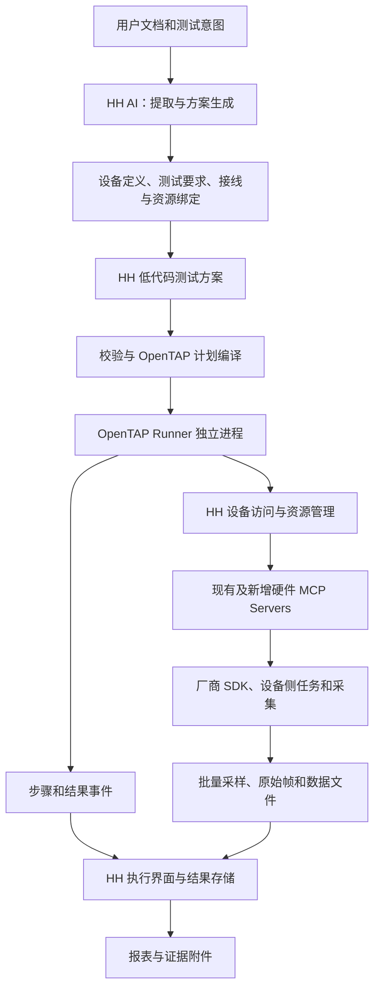

**针对 HardwareHarness 七步使用场景的选型与架构建议**

日期：2026-09-16。范围：比较 OpenTAP 与 EEZ Studio，结合 HH 已有设备库、端口针脚、接线契约和硬件 MCP 服务，提出下一阶段通用测试设计。本次没有读取现有编排功能或日志系统的实现，没有修改应用代码，没有安装或运行候选引擎。以下新增对象、接口与组件均为建议，不表示 HH 已经实现。

**推荐结论**

在继续以 HH 为用户主入口、硬件资源以 MCP Server 提供的前提下，优先选择 **HH 自有测试方案编辑器 + OpenTAP 执行内核 + HH 硬件访问层 + 现有 MCP Servers**。

OpenTAP 可以补上测试步骤、结果判定、资源生命周期、扫描、并行、结果监听等核心机制。HH 保留 AI、设备库、接线和产品界面。这里选择的是 OpenTAP 引擎，不要求用户切换到 Keysight GUI，也不依赖其商业/社区许可编辑器。

EEZ Studio 适合把它本身作为仪器控制和可视化应用工作台。如果 HH 仍要拥有统一设备库、接线画布、AI 和测试编辑体验，EEZ 的大部分现成 GUI 价值会与 HH 重叠；抽取 EEZ Flow 后，测试判定、运行实例、报告和异常恢复仍要建立。若实际优先级变成“接受外部工作台，尽快拥有完整拖拽流程与仪器面板”，EEZ 才更有优势。

这是基于源码与官方文档的推荐，是否采用应由后文的小型概念验证决定。两者目前都不能直接保证覆盖 customTest。

**结合 HH 的比较**

| 维度 | OpenTAP | EEZ Studio / EEZ Flow | 对 HH 的意义 |
|---|---|---|---|
| 核心模型 | TestPlan、TestStep、Instrument、DUT、Verdict、ResultListener | GUI、数据/控制流、仪器操作、事件和变量 | HH 当前更需要完整测试执行语义 |
| 低代码编辑 | 有现成编辑产品；HH 可经 API 自建编辑界面 | 已有完整图形界面与流程设计器 | 如必须统一在 HH 内，两者都有集成开发成本 |
| 步骤判定与结果汇总 | 现成测试结论和结果发布机制 | 可用变量与流程搭建，测试领域对象需补充 | OpenTAP 可减少结果体系的重复开发 |
| 控制流程 | 顺序、并行、条件、重复、参数扫描、子计划、锁、超时等基础步骤 | 循环、条件、事件、延时、用户动作、错误捕获等 | 两者能表达基础流程；差异在完整执行生命周期 |
| 运行状态反馈 | 官方步骤开始、发布结果、步骤结束、计划结束回调 | 有流程运行/调试能力；需映射为测试项运行状态 | OpenTAP 更直接对应“测试项目挨个执行” |
| MCP 接入 | 开发 Instrument/TestStep 适配器，经 HH 服务访问 MCP | 自定义动作或网络桥接访问 MCP | 本次未验证任一项目原生兼容 HH MCP 契约；均按需要适配估算 |
| 对现有原生驱动的影响 | 驱动继续留在 MCP Server 内 | 同样可保留 | MCP 已降低引擎语言与设备驱动语言之间的耦合 |
| 额外运行环境 | HH 之外增加 .NET runner 与部署维护 | 增加 EEZ 工作台，或抽取/嵌入其运行时 | 两者都有新增集成成本；不能只按界面截图判断 |
| 开源边界 | 核心 MPL-2.0；TUI 为 MIT；Keysight GUI 另许可 | Studio GPL-3.0；eez-framework 为 MIT | 自建 HH 前端可不依赖 Keysight GUI；改造 EEZ 编辑器需考虑 GPL 分发 |
| 底层实时性 | 不承诺板卡级实时性 | 同样不承诺 | 持续采集、协议周期、触发与快速保护应在设备侧完成 |
| 覆盖参考项目的主要开发量 | MCP 适配、领域动作、HH 方案编译、后台任务和报告映射 | 上述适配 + 测试运行实例、判定汇总与清理约定 | 本场景下 OpenTAP 的预期总工作量更低，需 PoC 验证 |

不能把 EEZ Studio 的桌面动作直接等同于独立 C++ runtime 的全部能力；Python、网络及桌面特有节点需按目标确认。也不能把 OpenTAP 的资源锁等同于跨所有 HH 客户端的设备独占锁。

**HH 已有基础与明确缺口**

已检查的设备层提供了可复用基础：

- `hardwareId / portId / pinId`、设备图片和端口图片；区分 managed/passive 设备。
- MCP 服务和实际硬件的关联、工具发现、输入/输出 schema 校验，以及部分契约元数据。
- 设备端 `get_server_info / get_hardware_info / get_pinout` 和带业务结果的 MCP 返回。
- 接线契约中的针脚对和 confirmedAt/confirmedBy；目录校验可检查端口、针脚存在性与重复。
- 当前纳入检查的服务包括 PCI-1710L、PCI-6208V、PCI-1762、CP-118U-I；目录另有 FireDAP。

目前持久化针脚定义只有 `pinId / position / label` 等基础信息。远端 Pinout 已经更丰富，包括 signal、direction、electricalType、channelKind/channelIndex、mode 和 sources。因此优先把现有远端能力保留下来，并补充电气范围与来源，不必重新发明全部针脚格式。

具体缺口及其影响：

| 事实 | 设计影响 |
|---|---|
| HH 针脚主模型较精简；validate_pins 检查的是引用与重复 | 能画出两根线不等于能判断电气兼容；要增加接口和电气约束校验 |
| PCI-6208V `read_last` 是软件影子值 | 不能把设置 1V 后 read_last=1V 当作 DUT 测试通过；应使用独立 ADC 或 DUT 返回量 |
| CP-118U-I 的 RS-232/422/485 模式由实体 DIP 决定 | AI 生成接线方案应标出需要核实的实体模式，不能用 UART 参数代替 |
| CP-118U-I `read_rx` 返回累计、不消费的缓存，截取最早前缀 | “等待本轮响应”需要采集边界/游标语义，否则旧响应可导致误判，新响应可能被前缀截断隐藏 |
| 设备动作目前串行处理 | 引擎并行不会自动提高同板卡并行度；长时间阻塞读不能占住停止/清理通道 |
| MCP 客户端目前对 `taskSupport=required` 工具报错 | 持续任务不能假设现有客户端已支持 MCP Tasks；需单独实现或采用显式 start/status/read/stop 业务接口 |
| MCP 响应时间戳是响应观察时间 | 波形或时序测试需要设备采样时间戳，不能以 UI 收到消息时间替代 |

以上只描述已读取的设备层；没有评价正在被另一会话清理的编排或日志实现。

**按七步场景划分职责**

| 用户步骤 | 应产生的持久产物 | HH / AI 的职责 | 执行引擎的职责 |
|---|---|---|---|
| 1. 提供 DUT 文档 | 文档版本、来源页码/表格、待澄清项 | 提取接口、供电、协议、模式、测试指标和限值 | 不负责文档理解 |
| 2. 添加设备 | DUT 定义及来源证据 | 创建端口针脚，关联图纸，保留未知值；允许用户修正 | 引用已定义 DUT |
| 3. 请求测试 | 测试意图、范围与覆盖清单 | 将要求拆成测试项，区分可执行、缺设备、缺协议、缺判据 | 只运行已明确的步骤 |
| 4. 生成接线方法 | 接线方案、仪器通道绑定、条件与确认记录 | 匹配仪器能力、生成针脚对、说明视角/模式/附件，校验兼容性 | 执行前检查绑定和必要的接线状态 |
| 5. 生成可编辑方案并执行 | 版本化测试计划及运行快照 | AI 与用户编辑同一份计划；校验并编译 | 运行固定快照；分支、循环、超时、取消和清理 |
| 6. 查看过程 | 测试项状态、测量点、曲线和数据附件 | 展示状态、当前动作、结果与异常；恢复断线后视图 | 发出步骤和结果事件；触发设备侧采集 |
| 7. 输出报表 | 带版本与证据引用的确定性报告 | 模板、导出、覆盖说明；AI 可另写分析摘要 | 提供真实结果、结论和执行元数据 |

“文档里只有接口”不能推导出完整验收标准。系统应能输出“通信可达性测试可生成，性能阈值待补充”，也可提出有明确标注的建议测试。不能将 AI 猜测的阈值写成厂家验收要求。

managed/passive 表示是否由 HH 服务控制；DUT、激励源、测量仪器是本次测试中的角色。两者应分开：某个 managed 设备也可以是本轮 DUT；没有 MCP Server 的 passive DUT 同样可以由外部仪器测试。

**建议结构**



OpenTAP Runner 可通过本机 RPC 访问 HH 的设备服务，由 HH 统一维护 MCP 会话、凭据、契约和资源占用。采用哪种 RPC 是实现细节，先用一个适配器验证，不应先引入完整的分布式基础设施。Runner 也可以实现 MCP 客户端直接连接设备服务，但会增加会话、权限与设备占用的一致性工作，第一阶段优先复用 HH 设备边界。

AI 和执行器都使用同一资源目录。AI 负责规划、修改和解释；执行时不需要模型逐步批准动作。AI 的临时手动操作也应服从设备占用，避免与已运行计划争抢同一通道。

HH 可以再向 AI 提供计划创建/修改、校验、启动、查询、停止和报告导出工具。这些工具作用于持久化计划与运行实例，并与界面按钮使用同一应用服务。AI 提交一次运行后即可查询状态，不需要保持对话持续生成。上述是建议新增的工具职责，不表示现有网关已经提供相应接口。

OpenTAP 控制流程的执行；HH 校验器负责计划合法性和编译，不应再实现第二套同义的循环/分支调度器。设备侧长期任务是受控子任务，不是另一个自主测试计划引擎。

**低代码方案建议采用“测试树 + 参数表单 + 数据绑定”**

首版可以直接显示测试项、子步骤、扫描参数和期望值。用户能插入/删除/排序、启停测试项、调整参数和阈值、查看所用设备与接线。对多通道、多轮次、有判据的测试，这比把每个 SDK 调用铺成大量节点更易读。后续若确需图形分支视图，应映射同一份计划。

建议一份结构化计划作为源：AI 生成它，HH 编辑它，编译器将它转换为 OpenTAP 对象或 `.TapPlan`。不要同时让用户编辑 HH JSON 与独立 `.TapPlan`，否则来源和行为容易分叉。已有原生 TapPlan 可作为后续受限导入功能，不必首版承诺任意双向转换。

计划至少表达：

- DUT 与测试要求引用；文档、设备定义、接线方案的版本。
- 逻辑资源，例如刺激源、测量通道、通信口；与实际 MCP 设备/通道的绑定。
- 参数、单位、限值、子流程，以及动作输入输出的类型化绑定。
- setup、测试主体、清理路径；重试、超时、暂停和错误处理策略。
- 要采集什么、何时采集、如何判定、保留哪些数据、报告采用什么模板。

示例测试树（示意，不代表某个真实 DUT 的已确认参数）：

```text
模拟量输入响应测试
  前置条件：已绑定刺激源、独立测量通道和 DUT 响应通道
  参数扫描：读取测试要求给定的激励点列表
    设置刺激源
    等待稳定条件，超过规定时间则报错
    测量实际激励
    获取 DUT 对该激励的响应
    按需求定义的换算和容差判定
    发布测量与测试结论
  清理：按设备配置和计划约定恢复输出
```

“测量实际激励”用于确认刺激条件；“DUT 响应”用于评估 DUT。两类结果应分开保留。若设备输出设置成功但 DUT 无响应，结果应是该测试异常/失败的相应状态，不能以工具调用成功替代测试通过。

**动作层如何复用 MCP**

可以由 `inputSchema / outputSchema / descriptions` 自动生成底层动作表单，再建立较稳定的测试动作目录：

| 动作类别 | 示例 | 与引擎/MCP 的关系 |
|---|---|---|
| 设备原子操作 | 配置通道、设置电压、读输入、发送字节 | 包装现有 MCP 工具；保留原始错误和证据语义 |
| 测试动作 | 等待新响应、等待稳定、采样并统计、比较限值、人工输入 | OpenTAP 自定义步骤和必要设备侧方法组合 |
| 控制动作 | 顺序、分支、循环、扫描、并行、子流程 | 优先映射 OpenTAP 基础步骤 |
| 长期任务 | 开始/停止采集、总线周期任务、读取增量数据 | 设备侧任务提供明确生命周期，计划持有任务句柄 |
| 结果动作 | 发布测量、关联原始文件、汇总要求覆盖 | 接入结构化结果与报告层 |

并不是每个 MCP 工具都应显示为可拖拽测试步骤。状态查询、服务维护和用户测试动作可使用不同目录视图。底层有通用 `McpCallStep` 有利于扩展，但如果整个产品只提供“工具名 + JSON”，低代码只是把编程负担转移给用户。

工具元数据需补充或归一化：稳定能力标识、契约版本、量纲、范围、物理端点/通道、锁范围、输出证据类型、副作用、取消方法和幂等性。MCP annotations 是提示，不足以单独决定物理动作的自动重放。

**设备和接线模型的补充范围**

设备定义建议区分以下信息；尽量复用现有字段而非平行建立另一套目录：

| 信息 | 作用 |
|---|---|
| 端口/针脚位置、连接器型号、插头/插座和视角 | 生成用户能实际照着操作的接线方法 |
| 信号方向、电气类型、电压/电流范围、参考地、差分组、终端要求 | 匹配测量设备并检查连接的适用条件 |
| 多功能针脚及激活模式 | 避免把不同模式下的功能同时使用 |
| 文档版本、页码、原始片段、未知/待确认状态 | AI 提取结果可复核，用户修改可追溯 |
| 测试要求与协议定义 | 决定具体测试方法和判据，不能仅靠引脚名称推导 |
| 逻辑信号→针脚→仪器通道→MCP 工具参数映射 | 将接线方案真正绑定到执行动作 |

“设备定义”“本次 DUT 实例”“测试台资源绑定”“接线计划/确认状态”应可分别保存和引用。一个设备型号可复用到多个 DUT 实例；同一测试计划可绑定不同测试台。换绑前必须重新校验量程、精度、采样能力和接线。

对于第 4 步，接线指导至少要显示两端设备/连接器/针脚、连接器视角、信号用途和必要模式。连接建议、用户确认完成与通过测量验证是不同状态。当前没有自动识别线缆的证据，不应在软件中自行标记“物理连接已验证”。

**执行、取消和采集的几个关键约定**

1. **固定运行快照。** 启动时冻结计划版本、动作版本、设备契约、绑定与接线版本。用户编辑产生新版本，默认不改变已运行步骤；可单独设计暂停后改参数的受限功能。
2. **设备占用是跨调用的。** OpenTAP 内的 Lock 只解决其作用域内的互斥。HH 需要覆盖 AI 手动调用、其他计划和设备服务的资源占用；存在绕过 HH 的客户端时，关键占用必须在设备端约束。先按整卡保守占用，再根据驱动证据细化到通道。
3. **打开资源不意味着立即施加激励。** OpenTAP 可能在计划初始化阶段并行打开资源；适配器的 Open 用于建立通信、检查和取得占用。上电/输出应作为满足前置条件后的显式步骤。
4. **取消与清理分开。** 停止新步骤、停止长期任务、恢复约定输出、关闭会话/释放占用要有明确顺序和超时。清理使用独立的时限，不能因为运行取消令牌已失效而全部被跳过。
5. **finally 保证有边界。** OpenTAP PostPlanRun 适合运行期收尾，步骤级资源还需 try/finally 或专用作用域步骤。进程崩溃、网络隔离或不可中断 SDK 不受普通 finally 保证；需要设备侧停止、看门狗/租约策略，并报告“设备状态未知”。
6. **调用超时不自动重试输出。** 先区分动作未开始、已执行、部分执行和结果未知；依据设备现状和动作幂等性恢复。操作 ID 能帮助去重，但不能自动创造跨设备 exactly-once 保证。
7. **高频任务留在设备侧。** MCP 发起任务、取状态和批量数据；采集服务按设备时间戳存储。不要每个样本调用一次 MCP，更不能每个样本请求一次 AI。
8. **后台任务不霸占停止通道。** 长期任务需有句柄、进度、完成状态、独立停止和数据游标；现有串行服务需要确认锁粒度后扩展。可先采用业务 `start/status/read/stop`，是否引入 MCP Tasks 单独决定。

这些约定服务于当前已有设备行为，尤其是串行调用、不可证明物理结果的回读，以及累计串口缓存；不是要求在首版建设通用分布式工作流平台。

**第 6、7 步的数据契约**

执行界面建议显示测试项树、当前步骤、实际值/期望值/单位、曲线、超时/错误和原始数据入口。每次循环或重试是不同的步骤实例，不能只用一个静态 stepId 覆盖历史。

最小关联标识可使用 `runId + stepId + invocationPath + attempt`，再关联 `requirementId / deviceId / channel / measurementId / artifactId`。实际字段名可在设计时确定。

应分别保存三类事实：步骤生命周期、类型化测量、原始附件。UI 可以降采样显示高频数据，原始文件另存。设备采样时间、主机收取时间和事件顺序各自保留，不混作同一时钟。

OpenTAP ResultListener 官方提供：

- `OnTestPlanRunStart`
- `OnTestStepRunStart`
- `OnResultPublished`
- `OnTestStepRunCompleted`
- `OnTestPlanRunCompleted`

这些回调在单独线程异步处理，适合结果收集和进度展示，不能依赖 UI 或结果监听回调的到达时间执行保护动作或控制设备时序。慢速 UI 不能阻塞设备停止；结果收集失败也需可观测并有明确策略。

报告由结构化事实和模板生成，可逐步支持 HTML/PDF、CSV/Excel 和参考项目的 Word/ATE 格式。报告应包括需求覆盖、计划版本、DUT 身份、实际资源和接线版本、设置/测量/判据、结论、原始附件引用。AI 的分析摘要可附加，但通过/失败统计与数值应来自确定性数据。

应区分未执行/跳过、测量不合格、设备或协议错误、用户取消和结论不足。缺设备或缺判据的要求列入未覆盖清单，不应从报表中消失。

**与 customTest 的覆盖关系**

| 参考软件 | 必须验证的代表能力 | 建议实现位置 |
|---|---|---|
| FKsoftProgram_CVI | 持续总线/串口任务与前台步骤并行，设备事件，原始数据，停止清理 | 设备侧任务 + OpenTAP 作用域/步骤 + HH 数据附件 |
| MPro | 前置子流程、文本/事件等待、分项超时、网络测试、设备异常处理 | HH 领域动作 + OpenTAP 分支/超时 + 设备侧保护 |
| NjRIUTestEQU | 参数化测试类、多通道扫描、循环、暂停、测量容差、Word/ATE | 动作目录 + 扫描/子计划 + 结构化测量和报告适配 |
| 总线接口显示控制模块测试设备测试软件 | Access 计划导入、多机位、测试频次、成功/失败统计、人工结果 | 计划导入器 + 机位绑定/运行上下文 + 测试动作/报告 |

还要区分**引擎表达能力覆盖**与**实际测试资源覆盖**：当前检查的 MCP 服务主要覆盖模拟量、离散量、继电器和串口，不能据此认为已有 1553B、ARINC429、L/RVDT、步进电机或所有视频/专用接口能力。对应板卡、适配器、协议插件和模拟实现仍需补齐。选择任何引擎都不会消除这部分工作。

长期覆盖应建立“旧测试项 → 测试要求 → HH 动作/计划 → 所需设备能力 → 数据与报告字段”的逐项清单。原有固定业务可能先包装为粗粒度动作过渡，但最终要逐步暴露参数和测试子步骤，才满足用户低代码修改及逐项观察的要求。

**下一阶段建议顺序**

| 阶段 | 交付物 | 验收点 |
|---|---|---|
| 1. 一条纵向 PoC | HH 可编辑计划、OpenTAP runner、一个 MCP 适配器、一个结果监听器 | 无 Keysight GUI 能运行；修改参数不改代码；UI 看到步骤和数据；生成一次报告 |
| 2. 方案与资源契约 | 文档来源、DUT 定义、能力绑定、接线约束、计划 schema | AI 和用户编辑同一计划；未知针脚/缺判据/资源不匹配能明确阻止受影响步骤 |
| 3. 执行生命周期 | 占用、暂停取消、作用域清理、后台任务与游标 | 串口旧数据不误判；并行机位不串扰；超时/断开/停止有明确设备状态 |
| 4. 参考项目覆盖 | 旧测试项映射清单、专用硬件 MCP 适配和回放数据 | 四套软件的代表场景及逐项功能通过模拟与硬件验收 |

第一条 PoC 建议使用模拟 DUT 与模拟 MCP 服务；可选已有 AO/AI/串口资源接入作为第二阶段。测试必须包含正常、越限、超时、取消和通信中断，并验证 AO 软件影子值不会被当作 DUT 测量结果。

OpenTAP 采用门槛：通过已公开 API 构建/运行计划、暴露运行事件；.NET runner 能经 HH 调用设备；参数和测量映射清楚；清理与结果完成顺序可验证；部署体积与启动时间可接受。未通过这些门槛前，不建议大规模改造 HH。

EEZ 的对照 PoC 只在确有必要时实施：相同测试、相同 MCP 服务，验证外部 Studio 或嵌入方式下的编辑、错误处理、取消与结果上报。若为了统一到 HH 内部而需要同时维护两个完整编辑器、两套计划和两套运行状态，则其集成成本已偏离本场景的目标。

**本次依据**

- HH 设备定义：`HardwareHarness/packages/contracts/src/devices.ts:85`；Python 对应 `contracts/devices.py`。
- 目录与针脚校验：`HardwareHarness/python/src/hardwareharness_backend/devices/device_catalog_service.py:98`。
- MCP 传输抽象：`HardwareHarness/python/src/hardwareharness_backend/devices/device_transport.py:30`。
- MCP 发现/校验与任务支持：`HardwareHarness/python/src/hardwareharness_backend/devices/mcp_client.py:48`。
- 接线契约：`HardwareHarness/python/src/hardwareharness_backend/contracts/wiring.py:28`。
- 远端丰富 Pinout：`mcp_servers/servers/pci1710l/app/src/hardwareharness_remote/pinouts.py:11`。
- 各硬件 `mcp_servers/servers/*/README.md` 和 `contracts.py` 的公开结果语义。
- [OpenTAP 架构/API](https://github.com/opentap/opentap/blob/main/doc/Developer%20Guide/What%20is%20OpenTAP/Readme.md)。
- [OpenTAP 步骤生命周期](https://github.com/opentap/opentap/blob/main/doc/Developer%20Guide/Test%20Step/Readme.md)。
- [OpenTAP 结果监听](https://github.com/opentap/opentap/blob/main/doc/Developer%20Guide/Result%20Listener/Readme.md)。
- [OpenTAP 编辑器边界](https://github.com/opentap/opentap/blob/main/doc/User%20Guide/Editors/Readme.md)。
- [EEZ Studio 功能与许可](https://github.com/eez-open/studio/blob/master/README.md)。
- [EEZ Flow 动作](https://github.com/eez-open/studio/tree/master/help/en-US/components/actions) 与 [C++ framework](https://github.com/eez-open/eez-framework)。

公共文档本次经 raw.githubusercontent.com 补充读取；GitHub Contents API 当时返回限流。当前建议不依赖正在清理的编排/日志代码结构，可作为后续设计和概念验证的独立输入。
